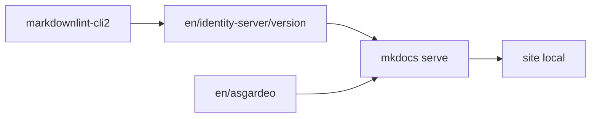

# wso2/docs-is

> MkDocs sources of the documentation for WSO2 Identity Server and the Asgardeo identity platform.

## The problem
Producing and reviewing the documentation of two identity products, with style checks.

## What it actually does
Contains the content of is.docs.wso2.com and wso2.com/asgardeo/docs. Runs locally with MkDocs in a Python virtual environment or a VS Code dev container. Markdown linters (markdownlint-cli2) in CI. A SaaS / self-hosted selector reads a `page-manifest.js` from the target site.

## How it is wired


## Trying it
```bash
git clone https://github.com/wso2/docs-is.git
cd en/asgardeo && python3 -m venv .venv && source .venv/bin/activate
pip3 install -r requirements.txt
mkdocs serve
```

## Cost and gotchas
Free. You must accept a CLA to contribute.

## What it is not
Neither the WSO2 Identity Server product, nor generic documentation: only the sources of these sites.

## Alternatives
No alternative named in the README.

## For you
Ignore: documentation sources of an identity product, useful only if you contribute to WSO2.
