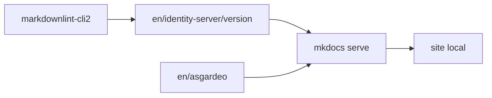

# wso2/docs-is

> Sources MkDocs de la documentation de WSO2 Identity Server et de la plateforme Identity Asgardeo.

## Le problème
Produire et relire la documentation de deux produits d'identité, avec contrôles de style.

## Ce que ça fait vraiment
Contient les contenus de is.docs.wso2.com et wso2.com/asgardeo/docs. Se lance en local avec MkDocs dans un environnement Python virtuel ou un dev container VS Code. Linters markdown (markdownlint-cli2) en CI. Un sélecteur SaaS / auto-hébergé lit un `page-manifest.js` du site cible.

## Comment c'est branché


## Essayer
```bash
git clone https://github.com/wso2/docs-is.git
cd en/asgardeo && python3 -m venv .venv && source .venv/bin/activate
pip3 install -r requirements.txt
mkdocs serve
```

## Coût et pièges
Gratuit. Il faut accepter un CLA pour contribuer.

## Ce que ce n'est pas
Ni le produit WSO2 Identity Server, ni de la documentation générique : seulement les sources de ces sites.

## Alternatives
Aucune alternative nommée dans le README.

## Pour toi
Ignorer : sources de doc d'un produit d'identité, utile seulement si tu contribues à WSO2.

