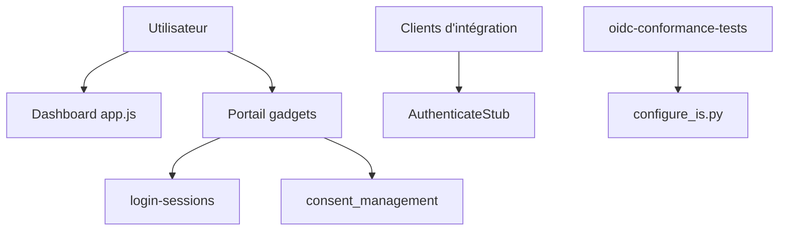

# wso2/product-is

> Identity and access server (SSO, OAuth2, SAML, B2B) from WSO2, for security teams.

## The problem
Managing authentication, authorization and user accounts for many applications in one place is complex.

## What it actually does
Provides an administration console, a user portal, an authentication flow designer and fine-grained access control, with support for standards such as FAPI. The repo also contains integration clients, test scenarios and an OIDC conformance tool. No detailed wiring diagram available.

## How it is wired
Diagram based on the code's diagram.


## Trying it
```bash
# Extraire la distribution, JAVA_HOME défini, puis :
./bin/wso2server.sh
# console : https://localhost:9443/console (admin / admin)
```

## Cost and gotchas
Free, but it needs a JDK from 11 to 21 (Java is not in the prerequisites list: real need). Commercial support is paid. More than 1,600 open issues. Change the default credentials.

## What it is not
Not a lightweight tool: it is an enterprise platform to deploy and maintain. Not an AI service.

## Alternatives
No alternative named in the README (Asgardeo is the same vendor's hosted version).

## For you
Ignore unless you have to set up enterprise SSO: heavy and unrelated to your daily data / AI work.
