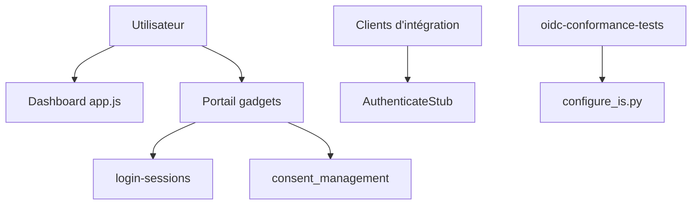

# wso2/product-is

> Serveur d'identité et d'accès (SSO, OAuth2, SAML, B2B) de WSO2, pour équipes de sécurité.

## Le problème
Gérer authentification, autorisation et comptes utilisateurs de nombreuses applications au même endroit est complexe.

## Ce que ça fait vraiment
Fournit une console d'administration, un portail utilisateur, un concepteur de flux d'authentification et un contrôle d'accès fin, avec support de normes comme FAPI. Le dépôt contient aussi des clients d'intégration, des scénarios de test et un outil de conformité OIDC. Pas de diagramme de câblage détaillé disponible.

## Comment c'est branché
Schéma d'après le diagramme du code.


## Essayer
```bash
# Extraire la distribution, JAVA_HOME défini, puis :
./bin/wso2server.sh
# console : https://localhost:9443/console (admin / admin)
```

## Coût et pièges
Gratuit, mais il faut un JDK de 11 à 21 (Java n'est pas dans la liste des prérequis : besoin réel). Le support commercial est payant. Plus de 1 600 issues ouvertes. Changer les identifiants par défaut.

## Ce que ce n'est pas
Pas un outil léger : c'est une plateforme d'entreprise à déployer et à maintenir. Pas un service d'IA.

## Alternatives
Aucune alternative nommée dans le README (Asgardeo est la version hébergée du même éditeur).

## Pour toi
À ignorer sauf si tu dois mettre en place un SSO d'entreprise : lourd et sans lien avec ton quotidien data / IA.

