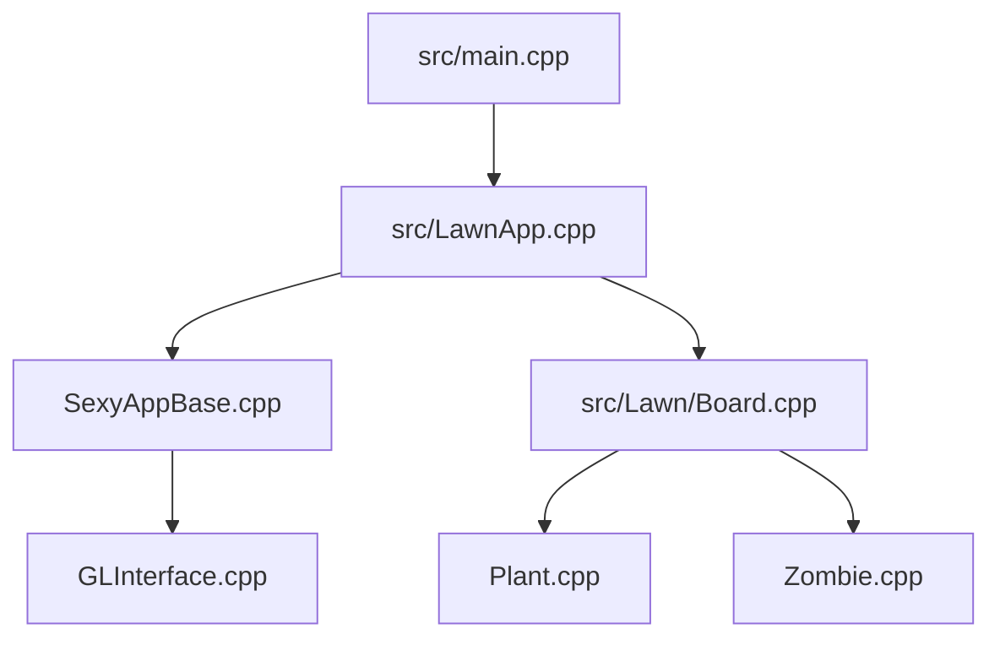

# wszqkzqk/PvZ-Portable

> Cross-platform C++20 reimplementation of Plants vs. Zombies GOTY, for those who already own the game.

## The problem
The original game is limited to Windows, at a fixed resolution, with fragile saves. A portable version is needed on desktop, mobile, console and browser.

## What it actually does
Rebuilds the engine in C++20 on SDL3 and OpenGL ES 2.0. Reads the original profiles and adds a portable `.v4` save format. Offers a resizable window, MO3 music via libopenmpt and recording of replayable games (`.dmo`). No assets provided: `main.pak` and `properties/` from a legal copy are required.

## How it is wired
Diagram based on the code diagram.


## Trying it
```bash
cmake -G Ninja -B build -DCMAKE_BUILD_TYPE=Release
cmake --build build
python3 scripts/make-compat-overrides.py "/path/to/main.pak"
```

## Cost and gotchas
Free, but you must buy the original game. Build with CMake, Ninja, SDL3 and libopenmpt if you do not take the binaries from the Releases. iOS requires sideloading.

## What it is not
Not a standalone game: without the official game files, nothing launches. Not a data or AI tool. Interface texts differ slightly depending on the asset version.

## Alternatives
No alternative named in the README.

## For you
Ignore for a data / AI / MLOps profile: it is a game port unrelated to your field, well done but off topic.
