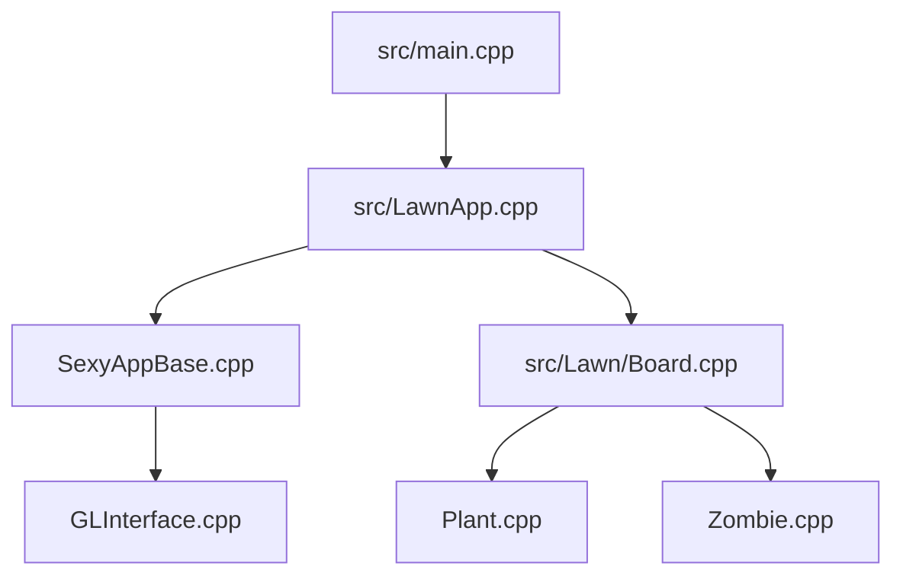

# wszqkzqk/PvZ-Portable

> Réimplémentation C++20 multiplateforme de Plants vs. Zombies GOTY, pour qui possède déjà le jeu.

## Le problème
Le jeu d'origine est limité à Windows, en résolution fixe, avec des sauvegardes fragiles. Il faut une version portable sur bureau, mobile, console et navigateur.

## Ce que ça fait vraiment
Reconstruit le moteur en C++20 sur SDL3 et OpenGL ES 2.0. Lit les profils d'origine et ajoute un format de sauvegarde `.v4` portable. Offre fenêtre redimensionnable, musique MO3 via libopenmpt et enregistrement de parties rejouables (`.dmo`). Aucun asset fourni : `main.pak` et `properties/` d'une copie légale sont requis.

## Comment c'est branché
Schéma d'après le diagramme du code.


## Essayer
```bash
cmake -G Ninja -B build -DCMAKE_BUILD_TYPE=Release
cmake --build build
python3 scripts/make-compat-overrides.py "/path/to/main.pak"
```

## Coût et pièges
Gratuit, mais il faut acheter le jeu d'origine. Compilation avec CMake, Ninja, SDL3 et libopenmpt si on ne prend pas les binaires des Releases. L'iOS demande un sideload.

## Ce que ce n'est pas
Pas un jeu autonome : sans les fichiers du jeu officiel, rien ne se lance. Pas un outil data ou IA. Les textes de l'interface diffèrent un peu selon la version des assets.

## Alternatives
Aucune alternative nommée dans le README.

## Pour toi
À ignorer pour un profil data / IA / MLOps : c'est un portage de jeu sans lien avec ton métier, bien fait mais hors sujet.

