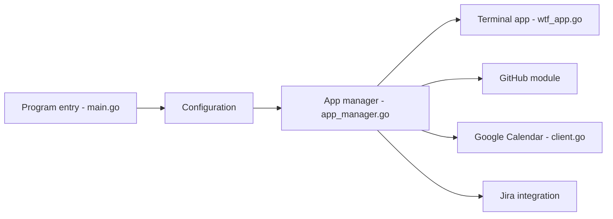

# wtfutil/wtf

> Personal terminal dashboard with configurable modules (GitHub, calendar, Jira…), for developers.

## The problem
Keeping useful but rarely consulted information in front of you, in one place.

## What it actually does
Go binary built on tcell and tview. A `config.yml` file enables modules (DigitalOcean, GitHub, Google Calendar, Hacker News, Have I Been Pwned, New Relic, OpsGenie, Security, Transmission, Trello) whose clients query external services. The project announces a rename to Tessera before v1.0.

## How it is wired


## Trying it
```bash
brew install wtfutil
wtfutil
go install github.com/wtfutil/wtf@latest
```

## Cost and gotchas
Free. Each module requires its own service credentials. Informally maintained by volunteers, with no guarantee of fixes (the README says so).

## What it is not
Not a monitoring or data science tool. MPL-2.0 license (weak copyleft, per file).

## Alternatives
No alternative is named in the README (tiny-care-terminal is cited as inspiration).

## For you
Ignore: a productivity gadget unrelated to data/AI/MLOps work, and a project in transition.
