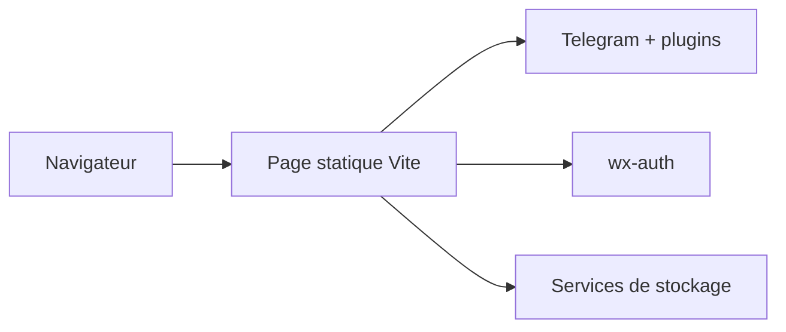

# wu529778790/panhub.shenzjd.com

> Cloud storage resource search engine aggregating Telegram and plugins, as a static page.

## The problem
Finding a share across several Chinese storage services forces you to search source by source.

## What it actually does
A static Vite page that aggregates Telegram channels and third-party plugins, deduplicates, sorts, and probes link validity. Search is anonymous; "obtaining" (transfer) requires logging in through a separate authentication service, wx-auth. It supports Aliyun, Quark, Baidu, 115, Xunlei, UC, Tianyi, 123, Mobile Cloud, magnets.

## How it is wired


## Trying it
```bash
docker run -d --name panhub.shenzjd.com -p 8080:80 ghcr.io/wu529778790/panhub.shenzjd.com:latest
npm run build
```

## Cost and gotchas
Free. Login through a WeChat account; PolyForm Noncommercial license: commercial use is forbidden without permission.

## What it is not
Not a host: it hosts nothing and points to content whose rights status is not guaranteed. Requests must come from the browser.

## Alternatives
The README names no alternative.

## For you
Ignore: a storage-link aggregator, legal risk and a non-commercial license, no data/AI use.
