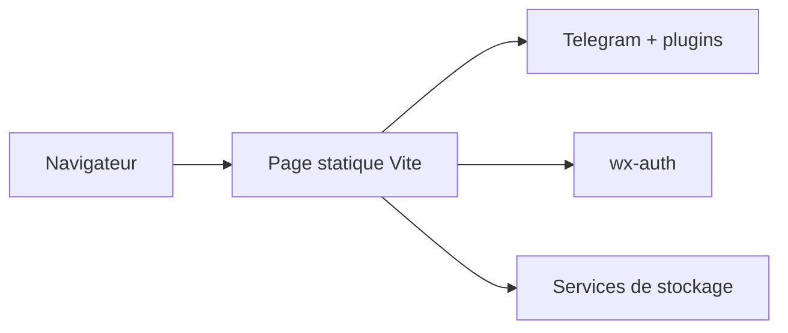

# wu529778790/panhub.shenzjd.com

> Moteur de recherche de ressources de stockage cloud agrégeant Telegram et plugins, en page statique.

## Le problème
Retrouver un partage sur plusieurs services de stockage chinois oblige à chercher source par source.

## Ce que ça fait vraiment
Page statique Vite qui agrège des canaux Telegram et des plugins tiers, dédoublonne, trie, sonde la validité des liens. Recherche anonyme ; l'« obtention » (transfert) exige une connexion via un service d'authentification séparé, wx-auth. Supporte Aliyun, Quark, Baidu, 115, Xunlei, UC, Tianyi, 123, Mobile Cloud, magnets.

## Comment c'est branché


## Essayer
```bash
docker run -d --name panhub.shenzjd.com -p 8080:80 ghcr.io/wu529778790/panhub.shenzjd.com:latest
npm run build
```

## Coût et pièges
Gratuit. Connexion via un compte WeChat ; licence PolyForm Noncommercial : usage commercial interdit sans accord.

## Ce que ce n'est pas
Pas un hébergeur : il n'héberge rien et renvoie vers du contenu dont le statut de droits n'est pas garanti. Les requêtes doivent venir du navigateur.

## Alternatives
Le README ne nomme pas d'alternative.

## Pour toi
À ignorer : agrégateur de liens de stockage, risque juridique et licence non commerciale, aucun usage data/IA.

