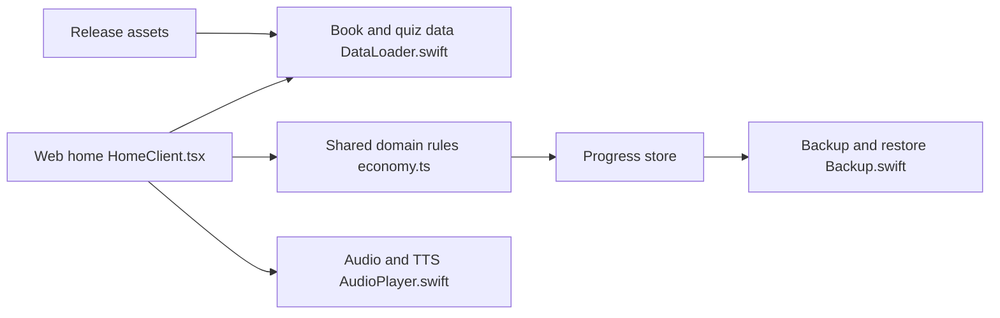

# wuwangzhang1216/ChinaTextbookStudyFree

> Free learning platform for Chinese primary school (language, math, English, science), web and iOS.

## The problem
Children without access to exercise textbooks and tutoring lack quality resources.

## What it actually does
Next.js web application and SwiftUI iOS application with 44 textbooks, 6,545 AI-generated exercises, 779 texts to listen to sentence by sentence, 284 illustrated stories and synthesized voice everywhere. Progress, error review, a cosmetics shop and a parental time limit are stored in the browser. Resources (audio, images, data) must be downloaded separately from a Release. A Python pipeline can regenerate the questions.

## How it is wired


## Trying it
```bash
git clone --branch main https://github.com/wuwangzhang1216/ChinaTextbookStudyFree.git
cd ChinaTextbookStudyFree
python3 scripts/install-release.py --tag v1.2.0-assets
npm ci
npm run dev
```

## Cost and gotchas
Free, but the resource download is about 2.06 GB and the MP3 conversion is slow on first launch; FFmpeg with `libmp3lame` required. Content generation uses paid API keys (optional pipeline).

## What it is not
Not content reviewed by teachers: the README states that the AI exercises are not all verified (1,498 lessons without explanation, 1,183 with a single question). The MIT license does not cover the textbooks, whose rights remain with their authors. No account, no synchronization between devices.

## Alternatives
- TapXWorld/ChinaTextbook: source of the textbook structure, cited in the README.

## For you
Ignore for a data/AI profile: educational product in Chinese, outside your scope, unless you want to study its generation and TTS pipeline.
