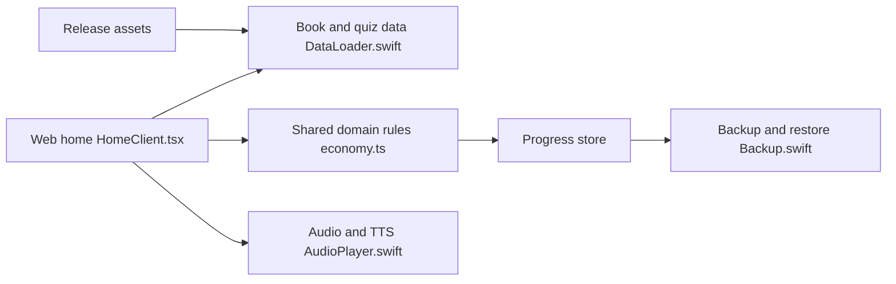

# wuwangzhang1216/ChinaTextbookStudyFree

> Plateforme gratuite d'apprentissage pour le primaire chinois (langue, maths, anglais, sciences), web et iOS.

## Le problème
Les enfants sans accès à des manuels d'exercices et à du soutien scolaire manquent de ressources de qualité.

## Ce que ça fait vraiment
Application web Next.js et application iOS SwiftUI avec 44 manuels, 6 545 exercices générés par IA, 779 textes à écouter phrase par phrase, 284 histoires illustrées et voix synthétique partout. Progression, révision des erreurs, boutique de cosmétiques et limite de temps parentale sont enregistrées dans le navigateur. Les ressources (audio, images, données) sont à télécharger séparément depuis une Release. Un pipeline Python peut régénérer les questions.

## Comment c'est branché


## Essayer
```bash
git clone --branch main https://github.com/wuwangzhang1216/ChinaTextbookStudyFree.git
cd ChinaTextbookStudyFree
python3 scripts/install-release.py --tag v1.2.0-assets
npm ci
npm run dev
```

## Coût et pièges
Gratuit, mais le téléchargement des ressources fait environ 2,06 Go et la conversion en MP3 est longue au premier lancement ; FFmpeg avec `libmp3lame` requis. La génération de contenu utilise des clés d'API payantes (pipeline en option).

## Ce que ce n'est pas
Pas un contenu relu par des enseignants : le README précise que les exercices IA ne sont pas tous vérifiés (1 498 leçons sans explication, 1 183 avec une seule question). La licence MIT ne couvre pas les manuels, dont les droits restent à leurs auteurs. Pas de compte, ni de synchronisation entre appareils.

## Alternatives
- TapXWorld/ChinaTextbook : source de la structure des manuels, citée dans le README.

## Pour toi
À ignorer pour un profil data/IA : produit éducatif en chinois, hors de ton périmètre, sauf si tu veux étudier son pipeline de génération et de TTS.

