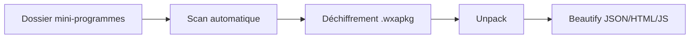

# wux1an/wxapkg

> Desktop tool (Wails) to decrypt and unpack WeChat `.wxapkg` mini-programs.

## The problem
Reading the source code of a WeChat mini-program distributed as an encrypted package.

## What it actually does
Scans the mini-programs installation folder, accepts a manual file or folder, rebuilds the source tree and beautifies JSON, HTML and JavaScript. Windows and macOS. "Get mini-program info" is still to do. References: pc_wxapkg_decrypt decryption and reverse-engineering notes.

## How it is wired


## Trying it
```bash
go install github.com/wailsapp/wails/v2/cmd/wails@latest
cd frontend && npm install && cd ..
wails build
```

## Cost and gotchas
Free. The README imposes a warning: study only, legal responsibility lies with the user. No license.

## What it is not
Not a complete security tool. Reverse engineering of third-party code: legal risk depending on use.

## Alternatives
No alternative named.

## For you
Ignore: reverse-engineering tool outside your scope, without a license and legally risky.
