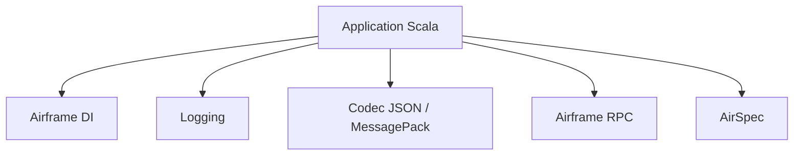

# wvlet/airframe

> Scala building blocks for applications: logging, JSON and MessagePack, dependency injection, RPC, testing.

## The problem
Assembling logging, serialization, dependency injection and RPC in Scala requires several disparate libraries.

## What it actually does
Set of modules: Airframe DI (injection with lifecycle), logging, JSON or MessagePack serialization, HTTP server and client with RPC, and AirSpec for testing. The README recommends Uni, its successor, for new Scala 3 projects.

## How it is wired
Simplified diagram based on the sheet, no diagram provided.



## Trying it
No usage commands in the README. For maintainers:
```bash
ruby ./scripts/release.rb
sbt mimaReportBinaryIssues
```

## Cost and gotchas
Requires Scala and sbt (not among the possible prerequisites listed). Published on Maven Central. The project pushes toward Uni for new work.

## What it is not
Not a data science or AI library. Not the recommended choice for a new Scala 3 project.

## Alternatives
- Uni: the Scala 3 successor, recommended by the README.

## For you
Ignore: general-purpose Scala tooling unrelated to AI, and the author already steers new projects toward Uni.
