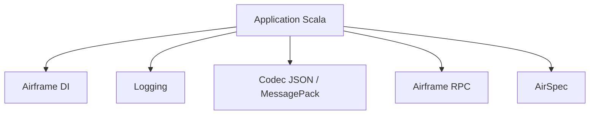

# wvlet/airframe

> Briques Scala pour applications : journalisation, JSON et MessagePack, injection de dépendances, RPC, tests.

## Le problème
Assembler en Scala la journalisation, la sérialisation, l'injection de dépendances et le RPC demande plusieurs bibliothèques disparates.

## Ce que ça fait vraiment
Ensemble de modules : Airframe DI (injection avec cycle de vie), logging, sérialisation JSON ou MessagePack, serveur et client HTTP avec RPC, et AirSpec pour les tests. Le README recommande Uni, son successeur, pour les nouveaux projets Scala 3.

## Comment c'est branché
Schéma simplifié d'après la fiche, sans diagramme fourni.



## Essayer
Aucune commande d'usage dans le README. Pour les mainteneurs :
```bash
ruby ./scripts/release.rb
sbt mimaReportBinaryIssues
```

## Coût et pièges
Nécessite Scala et sbt (non listés dans les prérequis possibles). Publié sur Maven Central. Le projet pousse vers Uni pour le neuf.

## Ce que ce n'est pas
Pas une bibliothèque de data science ou d'IA. Pas le choix recommandé pour un nouveau projet Scala 3.

## Alternatives
- Uni : le successeur Scala 3, recommandé par le README.

## Pour toi
Ignorer : outillage Scala généraliste sans lien avec l'IA, et l'auteur oriente déjà les nouveaux projets vers Uni.

