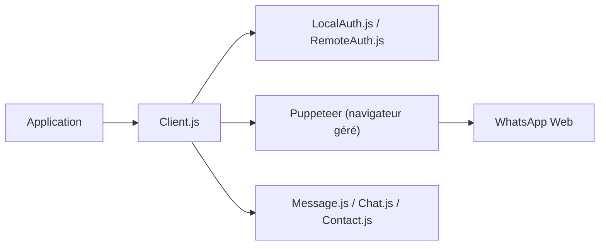

# wwebjs/whatsapp-web.js

> Node.js library that drives WhatsApp Web via Puppeteer, to build an unofficial WhatsApp bot or API.

## The problem
No simple access to WhatsApp from code without going through the official offering. The web client has to be automated to read and send messages.

## What it actually does
A `Client` launches a browser managed by Puppeteer, loads WhatsApp Web and calls its internal functions. It emits events (`qr`, `ready`, `message`) and converts results into typed objects: chats, contacts, messages, media, groups, channels, polls. Authentication is by QR code, with local (`LocalAuth`) or remote (`RemoteAuth`) session strategies.

## How it is wired


## Trying it
```bash
npm install whatsapp-web.js
yarn add whatsapp-web.js
pnpm add whatsapp-web.js
```
The README then provides a JS example (`client.on('qr', …)`, `client.initialize()`), not reproduced here.

## Cost and gotchas
Node.js 18 or later required. A WhatsApp account and a QR scan are needed. The README warns that WhatsApp forbids unofficial clients: account blocking cannot be ruled out.

## What it is not
It is not the official WhatsApp API and the project is not affiliated with anyone at WhatsApp. It offers no guarantee of continuity if WhatsApp Web changes. The README mentions no AI use.

## Alternatives
No alternative cited in the README.

## For you
Watch: useful for a notification or chatbot prototype, but the blocking risk and the dependency on a third-party service restrict it to experimentation.
