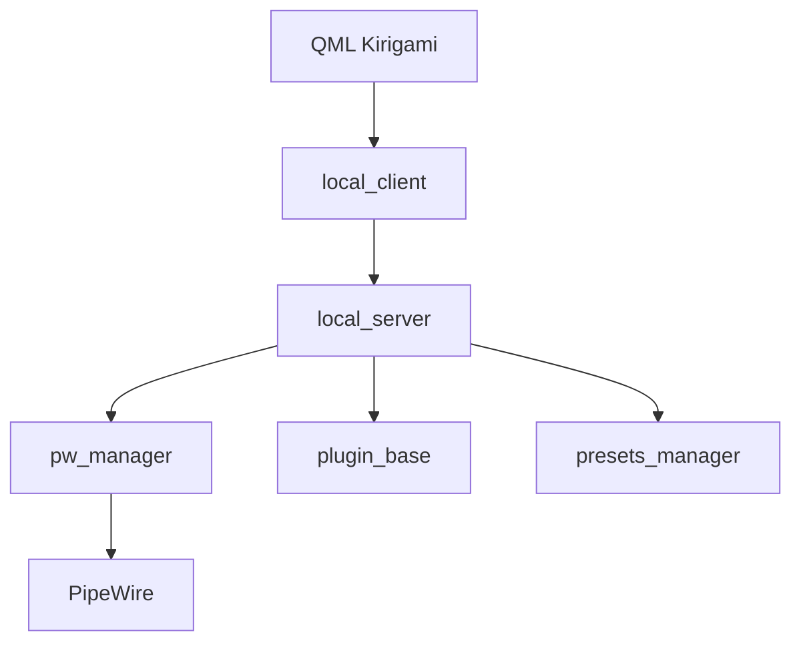

# wwmm/easyeffects

> Linux audio effects application (equalizer, compressor, noise reduction) for PipeWire.

## The problem
Applying effects and cleaning up system sound (microphone, output) without handling each application separately.

## What it actually does
Inserts a reorderable effects chain between the hardware and the applications: equalizer, compressor, reverb, RNNoise or DeepFilterNet denoising, pitch correction, and more than thirty others. The effects rely on LADSPA and LV2 plugins. Qt/QML interface with presets.

## How it is wired

## Trying it
No command in the README: install through your distribution's package or Flatpak; building is described on the wiki.

## Cost and gotchas
Free. Several external plugins (Linux Studio, Calf, RNNoise, etc.); the Flatpak includes them. Do not set the virtual devices as default.

## What it is not
Not an AI tool, despite the neural denoising. The README warns about an impersonating website that is probably fraudulent.

## Alternatives
No alternative named in the README.

## For you
Ignore: a Linux audio utility, with no direct relation to data, AI or MLOps, apart from cleaning up your microphone for recordings.
