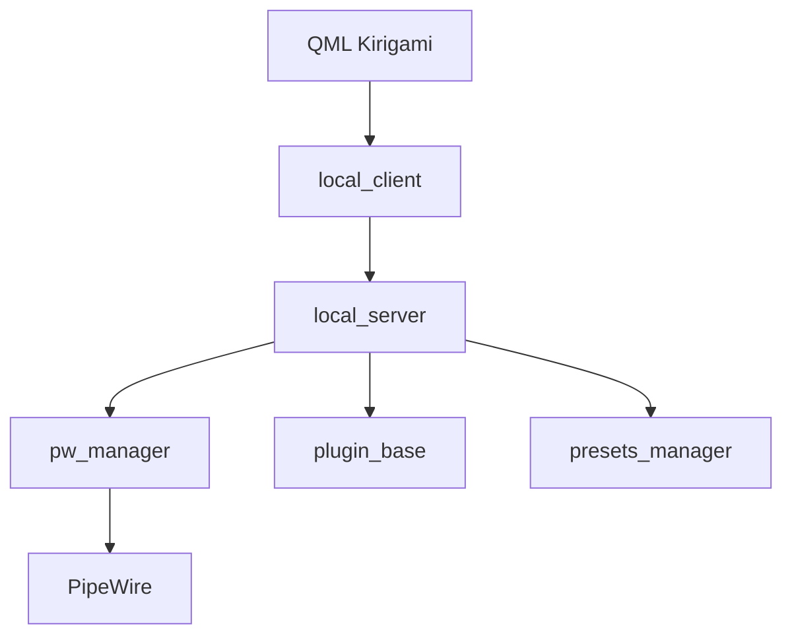

# wwmm/easyeffects

> Application Linux d'effets audio (égaliseur, compresseur, réduction de bruit) pour PipeWire.

## Le problème
Appliquer des effets et nettoyer le son système (micro, sortie) sans traiter chaque application séparément.

## Ce que ça fait vraiment
Insère une chaîne d'effets ordonnable entre le matériel et les applications : égaliseur, compresseur, réverbération, débruitage RNNoise ou DeepFilterNet, correction de pitch, et plus de trente autres. Les effets reposent sur les greffons LADSPA et LV2. Interface en Qt/QML avec présets.

## Comment c'est branché

## Essayer
Aucune commande dans le README : installation par le paquet de la distribution ou par Flatpak, compilation décrite sur le wiki.

## Coût et pièges
Gratuit. Plusieurs greffons externes (Linux Studio, Calf, RNNoise, etc.) ; le Flatpak les inclut. Ne pas définir les périphériques virtuels comme défaut.

## Ce que ce n'est pas
Pas un outil d'IA, malgré le débruitage neuronal. Le README alerte sur un site web usurpateur probablement frauduleux.

## Alternatives
Aucune alternative nommée dans le README.

## Pour toi
À ignorer : utilitaire audio Linux, sans rapport direct avec data, IA ou MLOps, hormis le nettoyage de micro pour tes enregistrements.

