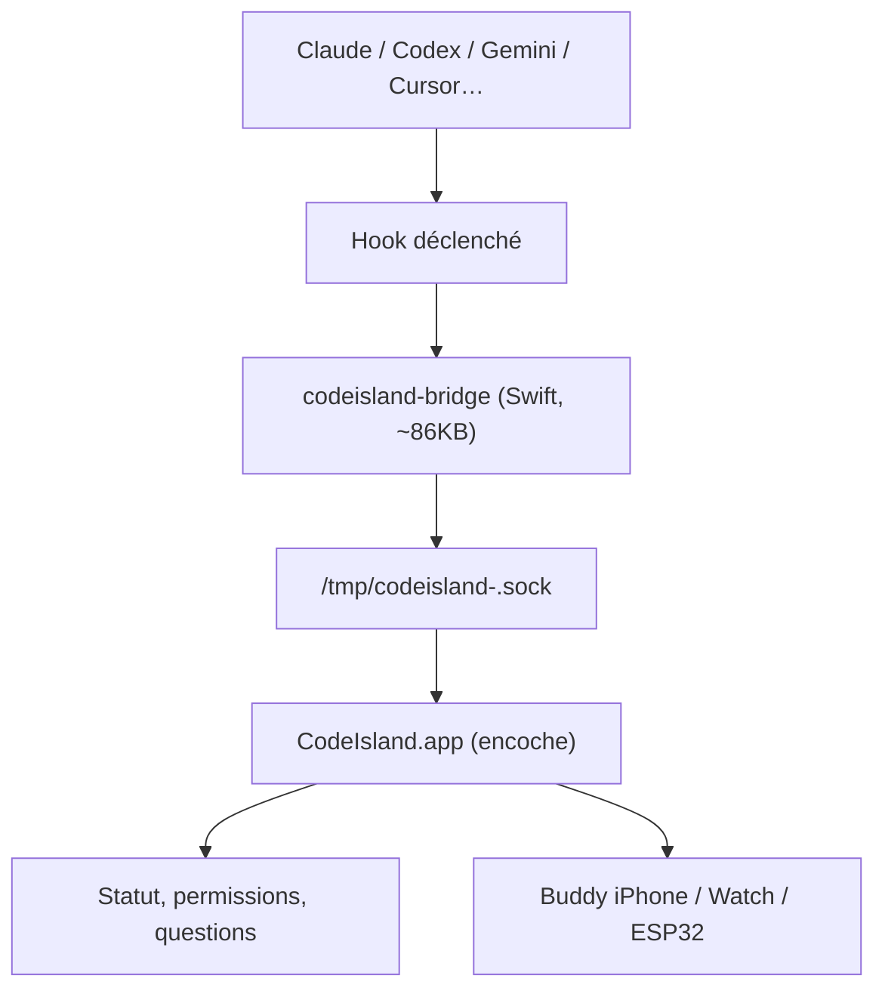

# wxtsky/CodeIsland

> Real-time status panel for coding agents, housed in the MacBook notch.

## The problem
Knowing whether Claude is waiting for approval or Codex has finished forces you to switch windows
constantly.

## What it actually does
Installs lightweight hooks in the configuration of 15 tools (Claude Code, Codex, Grok CLI,
Gemini CLI, Cursor, Copilot, Trae, Qoder, Factory, CodeBuddy, OpenCode, Kimi Code CLI, Cline,
Pi / Oh My Pi, DeepSeek Harness). Each event goes through a Swift binary
`codeisland-bridge` (~86 KB) then a Unix socket `/tmp/codeisland-<uid>.sock`; the app updates
the notch instantly. You approve or deny a permission from the panel, answer the agent's questions, and jump to the relevant terminal tab or IDE window. Optional mirroring to iPhone, Apple Watch and an ESP32 screen over BLE.

## How it is wired


## Trying it
```bash
brew tap wxtsky/tap
brew install --cask codeisland
git clone https://github.com/wxtsky/CodeIsland.git
swift build && ./.build/debug/CodeIsland
./build.sh
dsh plugin --profile <profile> add github:cdxiaodong/dsh-island
```

## Cost and gotchas
Free, but **macOS 14+ only** and Swift 5.9+ to build. On first launch macOS
shows a security warning to clear in Settings → Privacy. For Codex you
must also run `/hooks` and approve the entries manually, otherwise nothing happens
and no error message appears. The iPhone Buddy requires Local Network and Bluetooth permissions. The
ESP32 build documentation is in Chinese.

## What it is not
Not an agent manager: it displays and relays approvals, it does not launch or
orchestrate anything. Not cross-platform. The notch is not required but it is the
target use case.

## Alternatives
- claude-island by @farouqaldori, cited as the original inspiration.

## For you
Of no interest on Linux/WSL; a nice comfort if your main machine is a notched MacBook.
