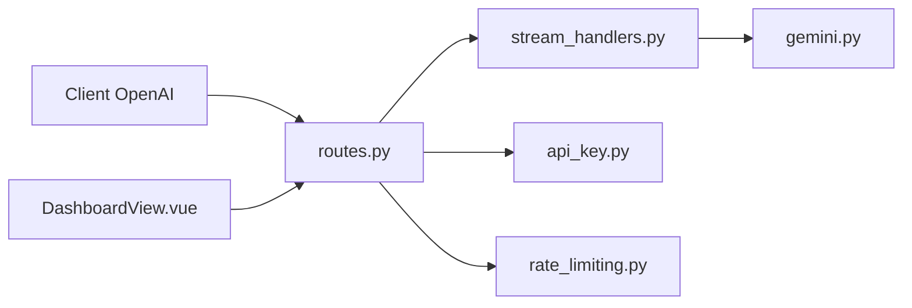

# wyeeeee/hajimi

> FastAPI proxy that exposes Gemini models through an OpenAI-compatible API, designed for free hosting.

## The problem
Clients that speak the OpenAI format cannot use Gemini keys directly, and a single key quickly hits its quota.

## What it actually does
Translates `/v1/chat/completions` requests to Gemini (text, files, images, function calls, streaming). Rotates through several Gemini keys, rate-limits per minute and per IP, offers a Vertex AI mode, a response cache, a "fake stream" (keep-alive during a non-streamed request), web search via a `-search` suffix and a Vue dashboard. A "disguise" mode adds a random string to messages to avoid being spotted as an automaton.

## How it is wired


## Trying it
```bash
pip install -r requirements.txt
uvicorn app.main:app --host 0.0.0.0 --port 7860
# ou image : ghcr.io/wyeeeee/hajimi:latest
```

## Cost and gotchas
Gemini keys are at your expense and quotas need watching. The default password is "123": change it. Repository archived, last push in September 2025: no more fixes.

## What it is not
Not a maintained product: archived. The "disguise" options aim to bypass automation detection, which may breach the provider's terms. No license identified by GitHub.

## Alternatives
No alternative named in the README.

## For you
Ignore: archived, unidentified license and circumvention features; use the official API or a maintained proxy instead.
