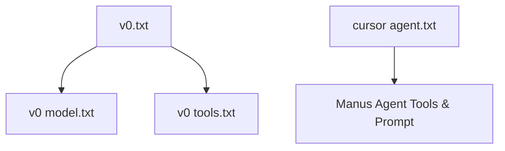

# x1xhlol/system-prompts-and-models-of-ai-tools

> Collection of AI tool system prompts (v0, Cursor, Manus), for those studying the behavior of agents.

## The problem
The system prompts used by commercial assistants are opaque; it is difficult to understand how they guide their agents and their tools.

## What it actually does
The repository contains text files: `v0.txt`, `v0 model.txt`, `v0 tools.txt`, `cursor agent.txt`, and a folder named "Manus Agent Tools & Prompt" (containing `agent loop`, `modules`, `prompt.txt`, and `tools.json`). The README, which is very short, provides no further details and does not mention the origin or verification of the texts.

## How it is wired

## Trying it
No documented command: clone the repository and read the text files.

## Cost and gotchas
Free. GPL-3.0 license (copyleft): please be aware of reuse restrictions. The README file includes advertising for a third-party service (ZeroLeaks).

## What it is not
Not a tool or executable code. The authenticity of the prompts cannot be verified according to the README. The files announced (cursor ask, cursor edit) are "coming soon".

## Alternatives
No alternative is specified in the README file.

## For you
Things to be aware of: This is a potential source of inspiration for designing your own agent prompts, but its reliability and the GPL license must be respected.
