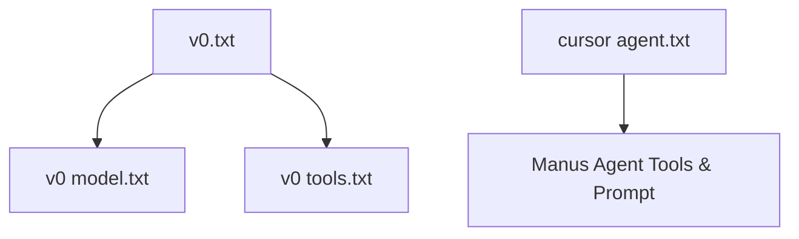

# x1xhlol/system-prompts-and-models-of-ai-tools

> Collection de prompts système d'outils IA (v0, Cursor, Manus), pour qui étudie le comportement des agents.

## Le problème
Les prompts système des assistants commerciaux sont opaques ; difficile de comprendre comment ils cadrent leurs agents et leurs outils.

## Ce que ça fait vraiment
Le dépôt stocke des fichiers texte : `v0.txt`, `v0 model.txt`, `v0 tools.txt`, `cursor agent.txt`, et un dossier « Manus Agent Tools & Prompt » (agent loop, modules, `prompt.txt`, `tools.json`). Le README, très court, ne détaille rien d'autre et ne mentionne ni origine ni vérification des textes.

## Comment c'est branché

## Essayer
Aucune commande documentée : cloner le dépôt et lire les fichiers texte.

## Coût et pièges
Gratuit. Licence GPL-3.0 (copyleft) : attention à la réutilisation. Le README mêle publicité pour un service tiers (ZeroLeaks).

## Ce que ce n'est pas
Pas un outil ni du code exécutable. Authenticité des prompts non vérifiable d'après le README. Les fichiers annoncés (cursor ask, cursor edit) sont « à venir ».

## Alternatives
Aucune alternative nommée dans le README.

## Pour toi
À surveiller : source d'inspiration pour concevoir tes propres prompts d'agents, mais provenance non garantie et licence GPL à respecter.

