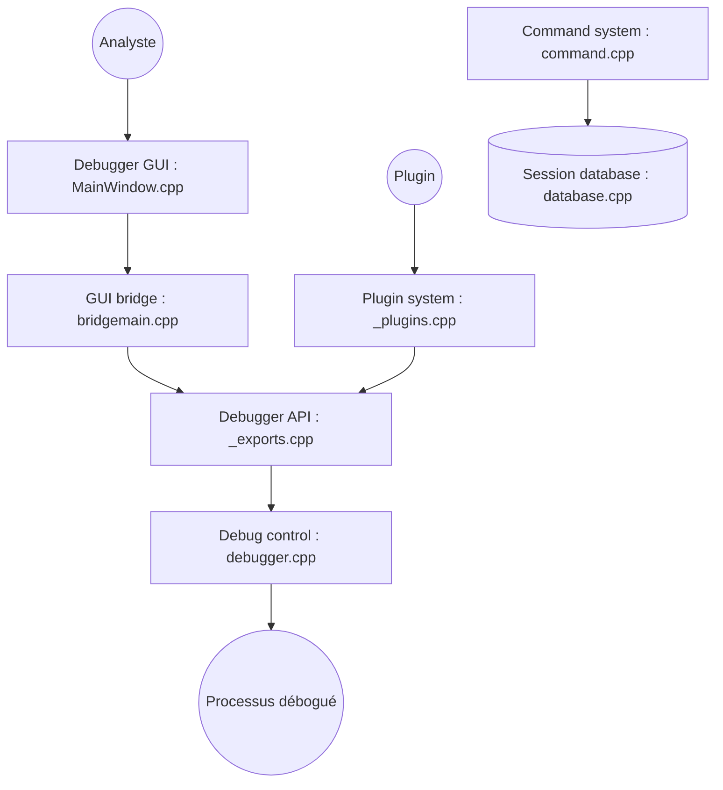

# x64dbg/x64dbg

> Open source binary debugger for Windows, intended for malware analysis and reverse engineering of executables.

## The problem
Understanding what an executable does when you don't have its source code, step by step, without a suitable tool.

## What it actually does
Launches or attaches to a Windows process, controls execution (breakpoints, single-stepping), and displays the disassembled code and the memory state. A session database keeps the analysis annotations. A plugin system lets you extend the tool. Separate 32-bit and 64-bit versions.

## How it is wired


## Trying it
```bash
# Aucune ligne de commande documentée. Étapes du README :
# 1. télécharger un snapshot (GitHub ou SourceForge) et l'extraire
# 2. facultatif : x96dbg.exe (extension shell, raccourcis)
# 3. x32\x32dbg.exe ou x64\x64dbg.exe selon l'exécutable à déboguer
```

## Cost and gotchas
Free, no key or account. Windows only according to the README. Debugging an unknown binary exposes the machine: do it in an isolated environment.

## What it is not
Not a tool for developing models or data. Not a source-code debugger for Python or the JVM: it works on the compiled binary. The license is present but not identified by GitHub.

## Alternatives
No alternative named in the README.

## For you
Ignore for a data / AI / MLOps profile: the tool is for Windows reverse engineering, outside your daily work, except for an occasional need to analyze a suspicious binary.
