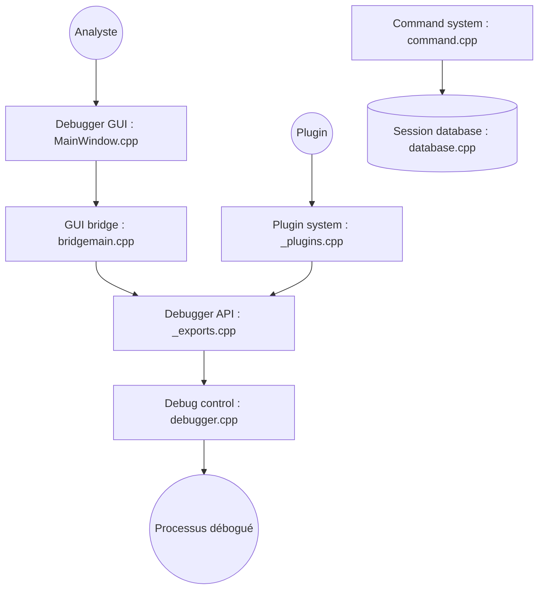

# x64dbg/x64dbg

> Débogueur binaire open source pour Windows, destiné à l'analyse de malwares et à la rétro-ingénierie d'exécutables.

## Le problème
Comprendre ce que fait un exécutable dont on n'a pas le code source, pas à pas, sans outil adapté.

## Ce que ça fait vraiment
Lance ou s'attache à un processus Windows, contrôle l'exécution (points d'arrêt, pas à pas), affiche le code désassemblé et l'état de la mémoire. Une base de session conserve les annotations d'analyse. Un système de plugins permet d'étendre l'outil. Versions 32 et 64 bits séparées.

## Comment c'est branché


## Essayer
```bash
# Aucune ligne de commande documentée. Étapes du README :
# 1. télécharger un snapshot (GitHub ou SourceForge) et l'extraire
# 2. facultatif : x96dbg.exe (extension shell, raccourcis)
# 3. x32\x32dbg.exe ou x64\x64dbg.exe selon l'exécutable à déboguer
```

## Coût et pièges
Gratuit, sans clé ni compte. Windows uniquement d'après le README. Déboguer un binaire inconnu expose la machine : à faire en environnement isolé.

## Ce que ce n'est pas
Pas un outil de développement de modèles ni de données. Pas un débogueur de code source Python ou JVM : il travaille sur le binaire compilé. La licence est présente mais non identifiée par GitHub.

## Alternatives
Aucune alternative nommée dans le README.

## Pour toi
À ignorer pour un profil data / IA / MLOps : l'outil sert à la rétro-ingénierie Windows, hors de ton quotidien, sauf besoin ponctuel d'analyser un binaire suspect.

