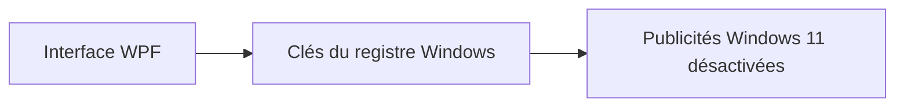

# xM4ddy/OFGB

> Small Windows 11 tool that edits the registry to disable system advertisements.

## The problem
An April 2024 update added advertisements in File Explorer, the Start menu and other places in Windows 11.

## What it actually does
The C# application with a WPF interface changes certain Windows registry keys to turn off these advertisements. Keys and comments come from Shawn Brink's script.

## How it is wired
Simplified diagram based on the sheet, no diagram provided.


## Trying it
```bash
git clone https://github.com/xM4ddy/OFGB
```

## Cost and gotchas
Free. Build with Visual Studio and the .NET 8.0 SDK, or use the published release. Last push in September 2024. Download only from GitHub.

## What it is not
Not a full system cleaner: it only touches registry keys related to advertisements. Windows only.

## Alternatives
No alternative named in the README.

## For you
Ignore: Windows comfort tweak, unrelated to data / AI / MLOps work.
