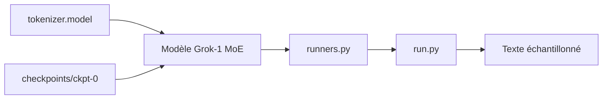

# xai-org/grok-1

> Example JAX code to load and sample the open weights of the Grok-1 LLM (314B).

## The problem
Without reference code, MoE weights of 314 billion parameters are unusable.

## What it actually does
`run.py` loads the `ckpt-0` checkpoint and samples on a test input.
Model: MoE with 8 experts (2 active per token), 64 layers, 8,192-token context, SentencePiece tokenizer with 131,072 entries.
The MoE layer is deliberately unoptimized (no custom kernels), to validate correctness.
Weights via torrent or Hugging Face.

## How it is wired


## Trying it
```bash
git clone https://github.com/xai-org/grok-1.git && cd grok-1
pip install huggingface_hub[hf_transfer]
huggingface-cli download xai-org/grok-1 --repo-type model --include ckpt-0/* --local-dir checkpoints --local-dir-use-symlinks False
pip install -r requirements.txt
python run.py
```

## Cost and gotchas
A multi-GPU machine with enormous memory is required. Last push in August 2024.

## What it is not
Not an efficient inference engine nor a documented instruction-tuned model; no fine-tuning provided.

## Alternatives
Not documented.

## For you
Historical curiosity; out of hardware reach and of no practical interest today.
