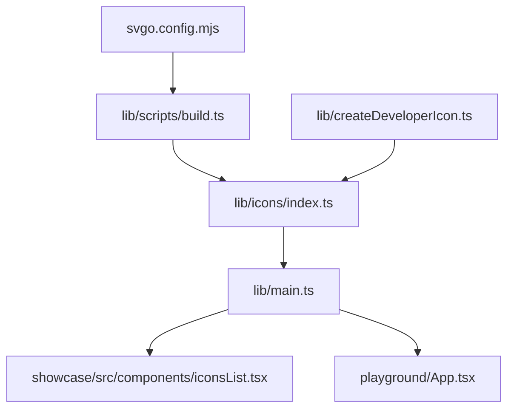

# xandemon/developer-icons

> Set of technology icons (languages, tools) as React components, with light and dark variants.

## The problem
Finding consistent, lightweight, resizable technology logos for a site or docs takes time.

## What it actually does
A build script optimizes the SVGs with SVGO and generates typed React components (size, color, style). An Astro site serves as a showcase, and a playground serves for testing. Light/dark and wordmark variants.

## How it is wired


## Trying it
```bash
npm i developer-icons
```
```javascript
import { HtmlIcon, JavascriptIcon } from "developer-icons";
```

## Cost and gotchas
Free. React only; the brands remain the property of their owners, and the README does not detail this point.

## What it is not
Not a generic UI icon set: these are technology logos.

## Alternatives
Lucide Icons, cited in the project's tech stack.

## For you
Watch: handy for a dashboard or an illustrated README, with no stake for data / AI work.
