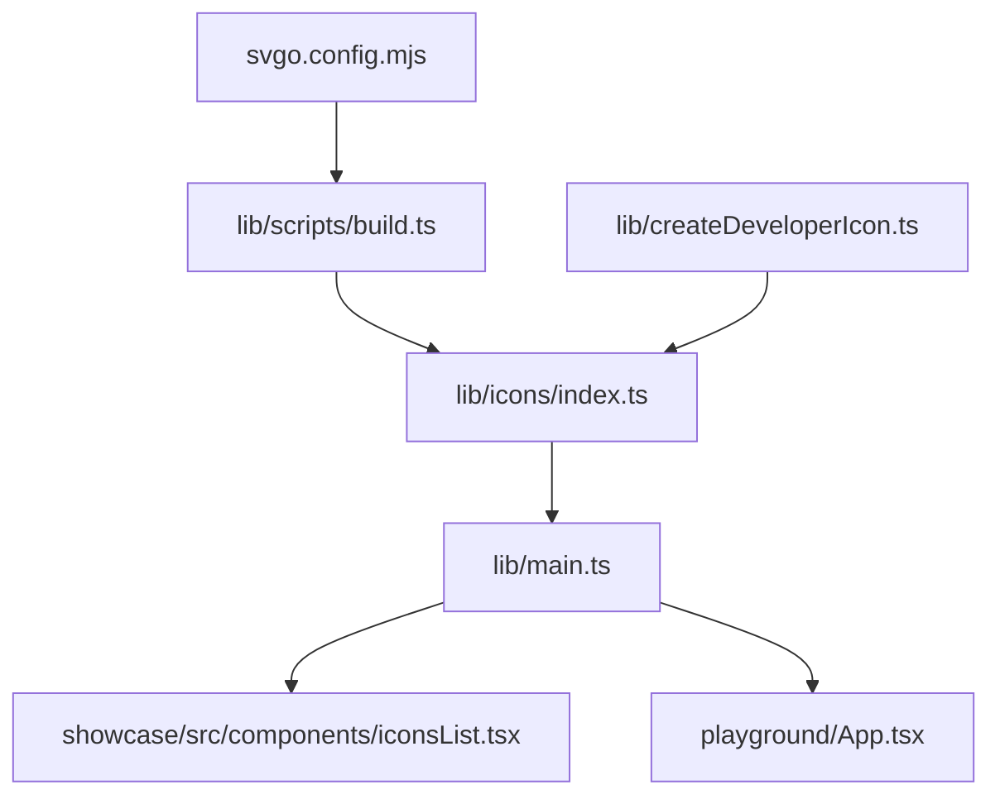

# xandemon/developer-icons

> Jeu d'icônes de technologies (langages, outils) sous forme de composants React, avec variantes clair et sombre.

## Le problème
Trouver des logos de technologies cohérents, légers et redimensionnables pour un site ou une doc prend du temps.

## Ce que ça fait vraiment
Un script de build optimise les SVG avec SVGO et génère des composants React typés (taille, couleur, style). Un site Astro sert de vitrine, un playground sert de test. Variantes clair/sombre et wordmark.

## Comment c'est branché


## Essayer
```bash
npm i developer-icons
```
```javascript
import { HtmlIcon, JavascriptIcon } from "developer-icons";
```

## Coût et pièges
Gratuit. Réservé à React ; les marques restent la propriété de leurs titulaires, le README ne détaille pas ce point.

## Ce que ce n'est pas
Pas un jeu d'icônes d'interface générique : ce sont des logos de technologies.

## Alternatives
Lucide Icons, cité dans la pile technique du projet.

## Pour toi
Surveiller : pratique pour un tableau de bord ou un README illustré, sans enjeu pour un travail data / IA.

