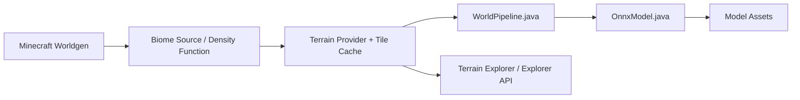

# xandergos/terrain-diffusion-mc

> Minecraft Fabric mod that generates world terrain with a diffusion model, for players and modders.

## The problem
Minecraft's terrain generation is procedural noise: few realistic continents, ranges or islands. This mod replaces that noise with the output of a learned model.

## What it actually does
The model outputs an elevation and 4 climate variables; hand-written rules (a 250-line classifier) convert them into Minecraft biomes. Inference runs locally via ONNX Runtime (DirectML on Windows, CUDA, CoreML or CPU). A scale from 1 to 6 sets the meters per block. The `/td-explore` command opens a local web map to scout the terrain. The models (~2.5 GB) are downloaded on first launch.

## How it is wired


## Trying it
```bash
./gradlew build -PuseDml=true   # Windows (DirectML)
./gradlew build -PuseCuda=true  # CUDA
./gradlew build -PuseCpu=true   # CPU / macOS CoreML
./gradlew buildAll
```
Otherwise: drop the jar from Releases into `mods/`, create a "Terrain Diffusion" world type.

## Cost and gotchas
Free. Requires Fabric + Fabric API, ~1.5 GB of VRAM, ~2.5 GB of RAM, Java 21+. The CPU build is slow outside macOS; the CUDA build requires CUDA + cuDNN. 133 open issues.

## What it is not
Not a general-purpose terrain generator: it is a Minecraft mod. Biome diversity remains limited by the manual rules, as the author acknowledges. No performance guarantee without a GPU.

## Alternatives
- Vanilla Minecraft terrain: no GPU or download needed, but less realistic.

## For you
Worth watching: the research (SIGGRAPH 2026) is a good example of diffusion embedded via ONNX, but the use remains recreational and outside the MLOps scope.
