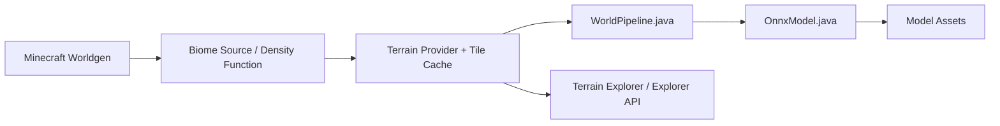

# xandergos/terrain-diffusion-mc

> Mod Minecraft Fabric qui génère le relief du monde avec un modèle de diffusion, pour joueurs et moddeurs.

## Le problème
La génération de terrain de Minecraft est du bruit procédural : peu de continents, de chaînes ou d'îles réalistes. Ce mod remplace ce bruit par la sortie d'un modèle appris.

## Ce que ça fait vraiment
Le modèle sort une élévation et 4 variables de climat ; des règles écrites à la main (classifieur de 250 lignes) les convertissent en biomes Minecraft. L'inférence tourne en local via ONNX Runtime (DirectML sous Windows, CUDA, CoreML ou CPU). Une échelle de 1 à 6 fixe les mètres par bloc. La commande `/td-explore` ouvre une carte web locale pour repérer le terrain. Les modèles (~2,5 Go) se téléchargent au premier lancement.

## Comment c'est branché


## Essayer
```bash
./gradlew build -PuseDml=true   # Windows (DirectML)
./gradlew build -PuseCuda=true  # CUDA
./gradlew build -PuseCpu=true   # CPU / macOS CoreML
./gradlew buildAll
```
Sinon : déposer le jar des Releases dans `mods/`, créer un monde de type « Terrain Diffusion ».

## Coût et pièges
Gratuit. Il faut Fabric + Fabric API, ~1,5 Go de VRAM, ~2,5 Go de RAM, Java 21+. Le build CPU est lent hors macOS ; le build CUDA demande CUDA + cuDNN. 133 issues ouvertes.

## Ce que ce n'est pas
Pas un générateur de terrain généraliste : c'est un mod Minecraft. La diversité des biomes reste limitée par les règles manuelles, l'auteur le reconnaît. Aucune garantie de performance sans GPU.

## Alternatives
- Le terrain vanilla de Minecraft : sans GPU ni téléchargement, mais moins réaliste.

## Pour toi
À surveiller : la recherche (SIGGRAPH 2026) est un bon exemple de diffusion embarquée via ONNX, mais l'usage reste ludique et hors périmètre MLOps.

