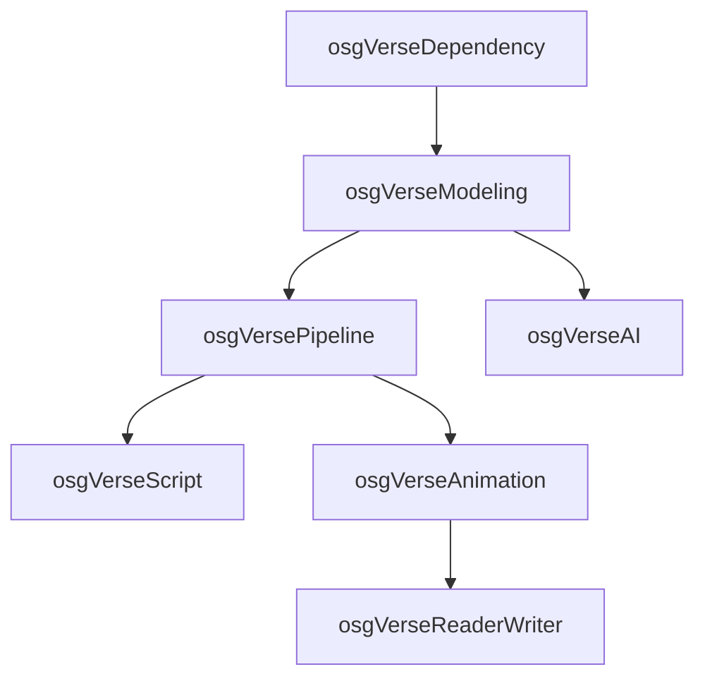

# xarray/osgverse

> Full 3D engine based on OpenSceneGraph, for rendering applications, digital twins and point clouds.

## The problem
OpenSceneGraph alone lacks modern rendering (PBR, shadows, deferred pipeline), readers for recent formats, and web or mobile ports.

## What it actually does
Adds to OpenSceneGraph a PBR and deferred pipeline, readers (FBX, GLTF, 3D Tiles, 3D Gaussian Splatting, point clouds), animation and physics (Box3D/Bullet3), Python/JsonRPC scripting, an AI module (ONNX models, navmesh) and WebAssembly, Android, Windows, Linux, macOS targets. The scene editor is described as initial.

## How it is wired


## Trying it
```bash
cd <osgverse>
./Setup.sh <options>   # Linux, télécharge OpenSceneGraph et propose un menu
# ou, voie classique :
mkdir build && cd build
cmake ..
cmake --build .
```

## Cost and gotchas
C++ compilation with CMake, OpenSceneGraph required, many optional dependencies (CUDA, FFmpeg, Qt...). The provided README is truncated mid-section in the Android part.

## What it is not
Not a computer vision or training framework: a 3D rendering engine. The AI module is limited to model loading and navigation.

## Alternatives
No alternative named in the README.

## For you
Ignore: a 3D rendering engine to compile, outside your scope unless you have a geospatial visualization or splatting project.
