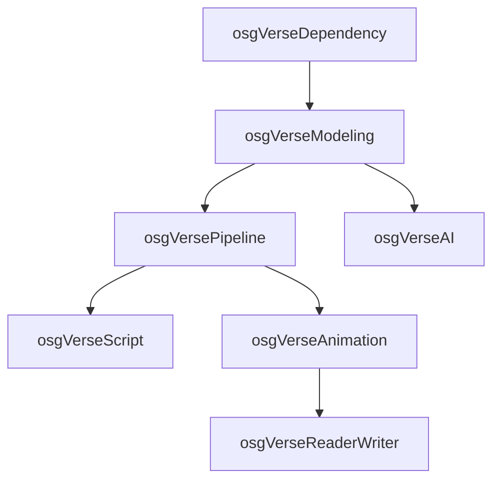

# xarray/osgverse

> Moteur 3D complet fondé sur OpenSceneGraph, pour applications de rendu, jumeaux numériques et nuages de points.

## Le problème
OpenSceneGraph seul manque de rendu moderne (PBR, ombres, pipeline différé), de lecteurs de formats récents et de portages web ou mobiles.

## Ce que ça fait vraiment
Ajoute à OpenSceneGraph un pipeline PBR et différé, des lecteurs (FBX, GLTF, 3D Tiles, 3D Gaussian Splatting, nuages de points), animation et physique (Box3D/Bullet3), scripts Python/JsonRPC, un module IA (modèles ONNX, navmesh) et des cibles WebAssembly, Android, Windows, Linux, macOS. L'éditeur de scène est annoncé comme initial.

## Comment c'est branché


## Essayer
```bash
cd <osgverse>
./Setup.sh <options>   # Linux, télécharge OpenSceneGraph et propose un menu
# ou, voie classique :
mkdir build && cd build
cmake ..
cmake --build .
```

## Coût et pièges
Compilation C++ avec CMake, OpenSceneGraph obligatoire, nombreuses dépendances optionnelles (CUDA, FFmpeg, Qt...). Le README fourni est tronqué en cours de section Android.

## Ce que ce n'est pas
Pas un framework de vision par ordinateur ni d'entraînement : un moteur de rendu 3D. Le module IA se limite au chargement de modèles et à la navigation.

## Alternatives
Aucune alternative nommée dans le README.

## Pour toi
Ignorer : moteur de rendu 3D à compiler, hors de ton périmètre sauf projet de visualisation géospatiale ou de splatting.

