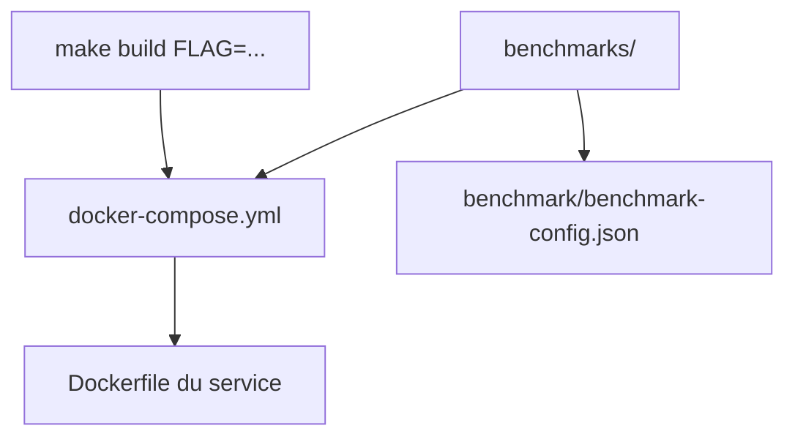

# xbow-engineering/validation-benchmarks

> 104 CTF-style web challenges, deliberately vulnerable, to evaluate AI-driven offensive tools.

## The problem
Measuring the skill of a web security agent requires varied, new and reproducible targets.

## What it actually does
Each folder in `benchmarks` is a challenge with `docker-compose.yml`, a Dockerfile and `benchmark-config.json` (level 1 to 3, tags, win condition). The flag is injected at build time. The README warns that these benchmarks are now saturated (about 100%) and kept for historical purposes.

## How it is wired


## Trying it
```bash
make build
make build FLAG=someflaggoeshere
```

## Cost and gotchas
Docker required. The applications contain unpatched vulnerabilities: isolate them in a sandbox, never in production.

## What it is not
Not an attack tool, but a set of targets. According to the README, more discriminating for comparing models.

## Alternatives
No alternative named in the README.

## For you
According to their authors the benchmarks are obsolete, so they have no value for evaluating an agent today: ignore.
