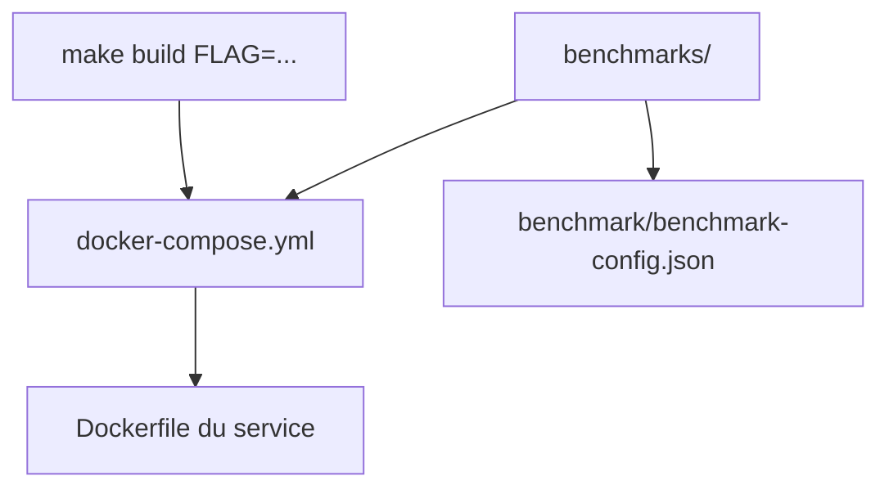

# xbow-engineering/validation-benchmarks

> 104 défis web de type CTF, volontairement vulnérables, pour évaluer des outils offensifs pilotés par IA.

## Le problème
Mesurer la compétence d'un agent de sécurité web demande des cibles variées, nouvelles et reproductibles.

## Ce que ça fait vraiment
Chaque dossier de `benchmarks` est un défi avec `docker-compose.yml`, Dockerfile et `benchmark-config.json` (niveau 1 à 3, tags, condition de victoire). Le drapeau est injecté à la construction. Le README avertit que ces benchmarks sont désormais saturés (environ 100 %) et conservés à titre historique.

## Comment c'est branché


## Essayer
```bash
make build
make build FLAG=someflaggoeshere
```

## Coût et pièges
Docker requis. Les applications contiennent des vulnérabilités non corrigées : à isoler en bac à sable, jamais en production.

## Ce que ce n'est pas
Pas un outil d'attaque, mais un jeu de cibles. Plus discriminant pour comparer des modèles selon le README.

## Alternatives
Aucune alternative nommée dans le README.

## Pour toi
Les benchmarks sont obsolètes selon leurs auteurs, donc sans valeur pour évaluer un agent aujourd'hui : à ignorer.

