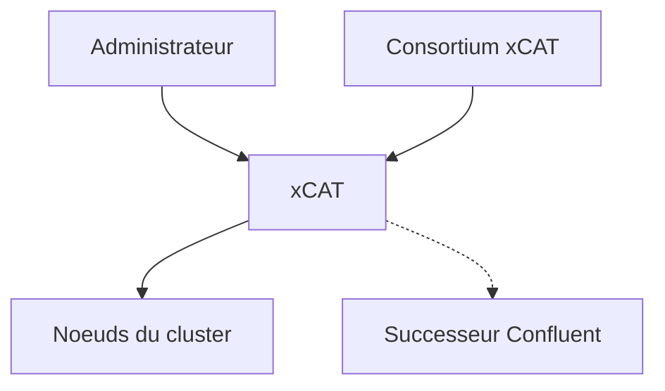

# xcat2/xcat-core

> Cluster deployment and administration toolkit, for HPC administrators.

## The problem
Installing, configuring and managing hundreds of compute nodes by hand is unmanageable.

## What it actually does
xCAT deploys and administers clusters of any size. The README is mostly about the state of the project: an announced end of life, then cancelled, with the xCAT consortium and VersatusHPC taking over development. Enterprise Linux 10 support is announced, not delivered. The consortium still recommends Confluent as the successor.

## How it is wired
Simplified diagram based on the sheet, no diagram provided.

## Trying it
No command documented in this README: everything goes through https://xcat-docs.readthedocs.io.

## Cost and gotchas
Free, EPL-1.0 license. 234 open issues. EL10 support is promised but absent today. Heavy setup, not detailed in the README.

## What it is not
Not a container orchestrator or a cloud tool. The README describes neither architecture nor installation.

## Alternatives
- Confluent: successor recommended by the consortium for new deployments.

## For you
Ignore: this is bare-metal cluster administration, far from everyday data or MLOps work, unless you manage an existing HPC cluster.
