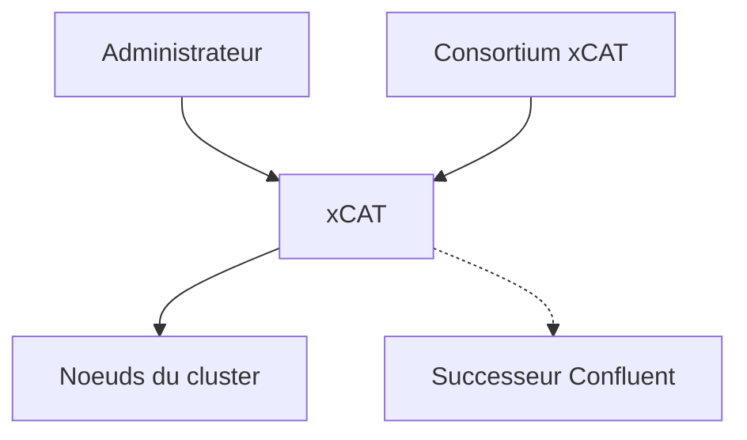

# xcat2/xcat-core

> Boîte à outils de déploiement et d'administration de clusters, pour les administrateurs HPC.

## Le problème
Installer, configurer et gérer des centaines de nœuds de calcul à la main est ingérable.

## Ce que ça fait vraiment
xCAT déploie et administre des clusters de toute taille. Le README raconte surtout l'état du projet : une fin de vie annoncée, puis annulée, avec le consortium xCAT et VersatusHPC qui reprennent le développement. Le support d'Enterprise Linux 10 est annoncé, pas livré. Le consortium recommande toujours Confluent comme successeur.

## Comment c'est branché
Schéma simplifié d'après la fiche, sans diagramme fourni.

## Essayer
Aucune commande documentée dans ce README : tout passe par https://xcat-docs.readthedocs.io.

## Coût et pièges
Gratuit, licence EPL-1.0. 234 issues ouvertes. Le support EL10 est promis mais absent aujourd'hui. Mise en place lourde, non détaillée dans le README.

## Ce que ce n'est pas
Pas un orchestrateur de conteneurs ni un outil cloud. Le README ne décrit ni architecture ni installation.

## Alternatives
- Confluent : successeur recommandé par le consortium pour les nouveaux déploiements.

## Pour toi
À ignorer : c'est de l'administration de clusters bare-metal, loin d'un travail data ou MLOps courant, sauf si tu gères un cluster HPC existant.

