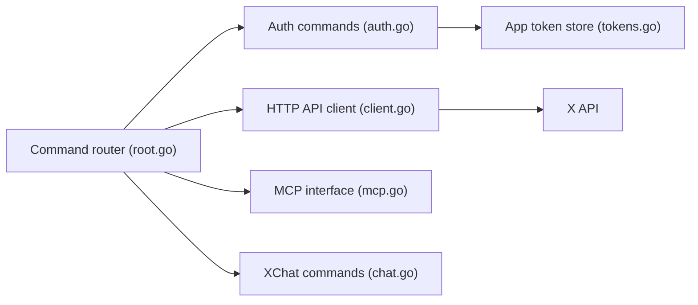

# xdevplatform/xurl

> Command-line, curl-style client for the X API, with OAuth, MCP and encrypted messaging.

## The problem
Calling the X API requires handling OAuth 1.0a, OAuth 2.0 PKCE and several applications with their tokens.

## What it actually does
Registers several X applications, obtains and refreshes tokens (stored in `~/.xurl/auth.yml`) and sends requests with headers, method and body. Detects streaming endpoints, uploads media in chunks, launches a temporary webhook via ngrok and prints a token (`xurl token`). `xurl mcp` bridges to the X API MCP server; `xurl chat` is an end-to-end encrypted XChat client, whose keys must already exist.

## How it is wired


## Trying it
```bash
brew install --cask xdevplatform/tap/xurl
xurl auth apps add my-app --client-id YOUR_CLIENT_ID --client-secret YOUR_CLIENT_SECRET
xurl auth oauth2 --app my-app
xurl /2/users/me
```

## Cost and gotchas
An X developer account and an application are needed; the README says you must switch the app to "Pay-per-use" and to production, otherwise `/2/*` reads fail. Tokens are stored in plain text in a YAML file. `chat` exists only on macOS and Linux amd64.

## What it is not
Not a general-purpose X client for reading your feed: it is an API tool for developers. Not free on the platform side.

## Alternatives
No alternative named in the README.

## For you
Worth watching: useful if you collect X data or plug an MCP agent into it, but paid API access limits its appeal.
