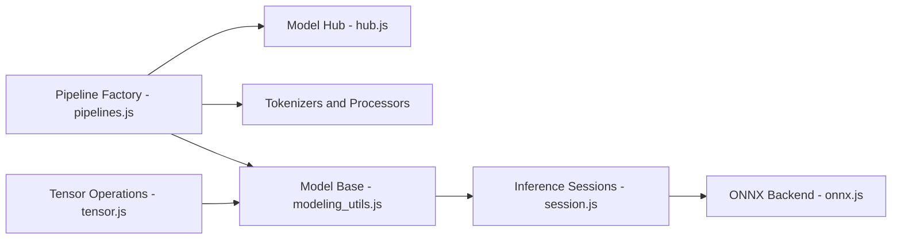

# xenova/transformers.js

> Runs Hugging Face models directly in the browser or in Node, via ONNX Runtime, without a server.

## The problem
Doing NLP, vision or audio inference client-side without deploying a Python backend.

## What it actually does
Reuses the `pipeline` API of the Python `transformers` library: text, vision, audio and multimodal tasks (classification, QA, summarization, object detection, ASR, TTS, embeddings). Runs in WASM on CPU by default or on WebGPU, with quantization chosen through `dtype` (fp32, fp16, q8, q4). PyTorch/TF/JAX models are converted to ONNX with Optimum. A structured-output package (JSON, regex) also exists.

## How it is wired


## Trying it
```bash
npm i @huggingface/transformers
```
```javascript
import { pipeline } from '@huggingface/transformers';
const pipe = await pipeline('sentiment-analysis');
const out = await pipe('I love transformers!');
```

## Cost and gotchas
Free. By default, models and WASM binaries come from remote CDNs; `env.allowRemoteModels = false` and `env.localModelPath` let you stay offline. WebGPU is still experimental in many browsers. Some tasks are not supported (tabular, text-to-image).

## What it is not
Not a full equivalent of the Python library: only models converted to ONNX run. Not suited to very large models in the browser.

## Alternatives
- Python `transformers` library: more complete, server-side.
- Optimum: converting your models to ONNX.

## For you
Adopt for demos or embedded inference without a server (embeddings, lightweight classification): same concepts as `transformers`, very simple deployment.
