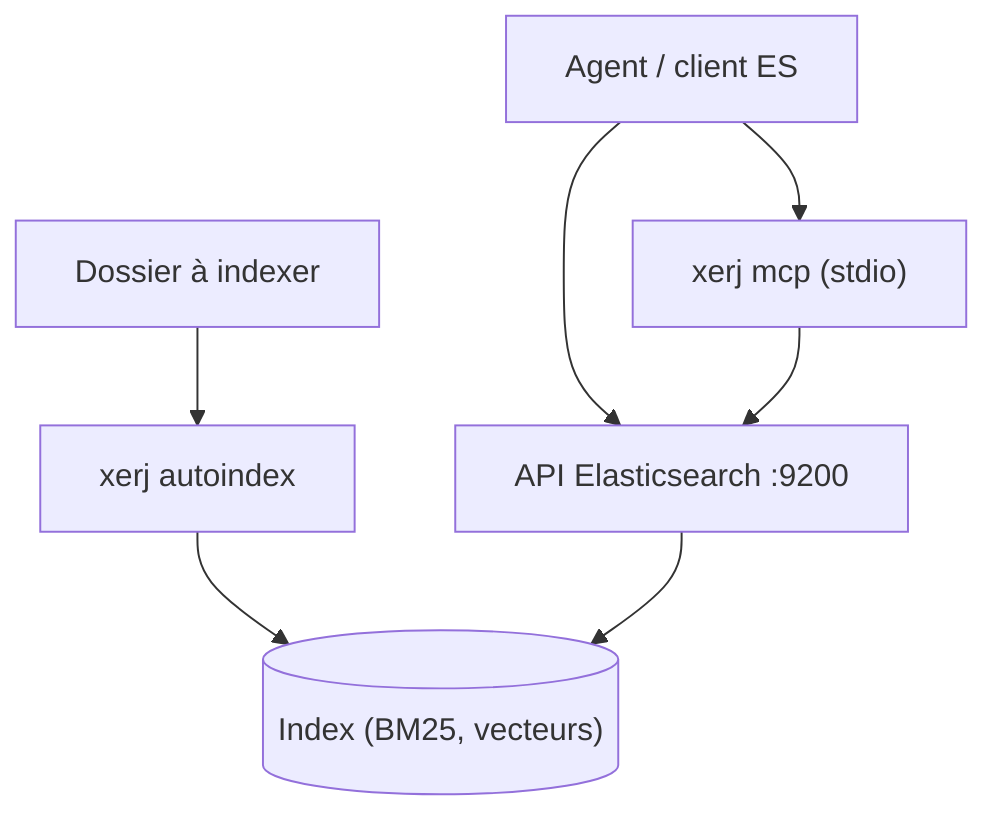

# xerj-org/xerj

> Local search engine in Rust, Elasticsearch-compatible, with an MCP server and memory for coding agents.

## The problem
A coding agent reads whole files to find one passage: costly in tokens and slow. A classic RAG adds an LLM and embeddings.

## What it actually does
A single binary indexes a folder (code via tree-sitter, docs, logs, PDF, CSV), offers BM25, vector and hybrid search, and answers through the Elasticsearch API or MCP. An optional model, Query-1, answers questions about facts written beforehand and returns `UNKNOWN` or `CONFLICT` when needed. The README claims 220 ms per question, measured by the author. It was truncated here, the end was not read.

## How it is wired

Diagram drawn from the README, no diagram provided.

## Trying it
```bash
curl -fsSL https://xerj.org/get | sh
xerj --insecure --data-dir ~/xerj-data &
xerj autoindex ~/my-project
xerj search "how do we rotate the WAL segment"
```

## Cost and gotchas
Free. `--insecure` turns off TLS and authentication: every caller becomes a superuser, so reserve it for a development machine. Jev reranking sends text to TypeSafe's servers. The data format changes between release candidates.

## What it is not
Not an LLM: Query-1 only answers from the facts provided, often declines, and gets sums wrong. The model is a binary whose training data is not public. The announced gains come from the author.

## Alternatives
No alternative named in the README.

## For you
Worth watching: the idea of a local Elasticsearch-compatible index for agents is useful, but the project is young, at release-candidate stage, and its figures are self-measured.
