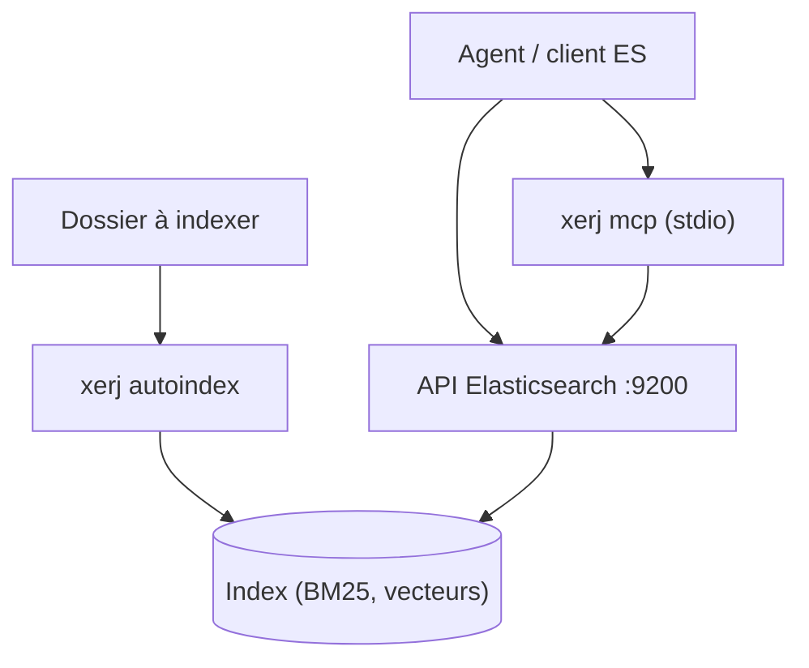

# xerj-org/xerj

> Moteur de recherche local en Rust, compatible Elasticsearch, avec serveur MCP et mémoire pour agents de code.

## Le problème
Un agent de code lit des fichiers entiers pour trouver un passage : coûteux en jetons et lent. Un RAG classique ajoute un LLM et des embeddings.

## Ce que ça fait vraiment
Un binaire unique indexe un dossier (code via tree-sitter, docs, logs, PDF, CSV), propose recherche BM25, vectorielle et hybride, et répond via l'API Elasticsearch ou MCP. Un modèle optionnel, Query-1, répond à des questions sur des faits écrits au préalable et renvoie `UNKNOWN` ou `CONFLICT` si besoin. Le README annonce 220 ms par question, mesures de l'auteur. Il a été tronqué ici, la fin n'a pas été lue.

## Comment c'est branché

Schéma tiré du README, aucun diagramme fourni.

## Essayer
```bash
curl -fsSL https://xerj.org/get | sh
xerj --insecure --data-dir ~/xerj-data &
xerj autoindex ~/my-project
xerj search "how do we rotate the WAL segment"
```

## Coût et pièges
Gratuit. `--insecure` coupe TLS et authentification : tout appelant devient superutilisateur, à réserver à une machine de développement. Le reranking Jev envoie du texte aux serveurs de TypeSafe. Le format de données change entre versions candidates.

## Ce que ce n'est pas
Pas un LLM : Query-1 ne répond qu'aux faits fournis, décline souvent et se trompe sur les sommes. Le modèle est un binaire dont les données d'entraînement ne sont pas publiques. Les gains annoncés viennent de l'auteur.

## Alternatives
Aucune alternative nommée dans le README.

## Pour toi
À surveiller : l'idée d'un index local compatible Elasticsearch pour agents est utile, mais le projet est jeune, en version candidate et ses chiffres sont auto-mesurés.

