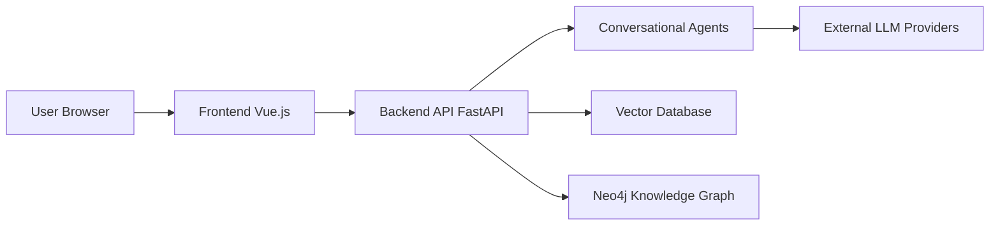

# xerrors/Yuxi-Know

> Self-hostable multi-user agent and RAG platform, for teams wanting to keep data and models in-house.

## The problem
Setting up a RAG, a knowledge graph and agents with per-user rights requires assembling several building blocks yourself.

## What it actually does
A Vue front end and a FastAPI API. Documents parsed (MinerU, PaddleOCR), indexed in Milvus, graph in Neo4j. LangGraph agents with sub-agents, Skills, MCP and a file sandbox. Per-user and per-department management, RAG evaluation.

## How it is wired


## Trying it
```bash
git clone --branch v0.7.3 --depth 1 https://github.com/xerrors/Yuxi.git
cd Yuxi
./scripts/init.sh
docker compose up --build -d
curl --fail http://localhost:5050/api/system/ready
```

## Cost and gotchas
API key from a model provider (SiliconFlow by default). Heavy Docker stack: Milvus, Neo4j, PostgreSQL, OCR. Migration from v0.7.1/0.7.2: backup and downtime window.

## What it is not
Not a lightweight tool: it is a complete stack. The catalog's license is not declared, while the README says MIT; third-party components have their own licenses. README mostly in Chinese.

## Alternatives
The README cites LightRAG, RAGFlow and DeerFlow as inspirations, without presenting them as substitutes.

## For you
Worth watching: useful if you want to test an in-house RAG plus graph, but the stack is heavy and the license is not confirmed in the catalog.
