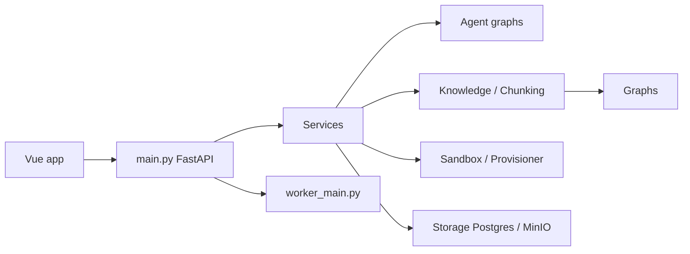

# xerrors/Yuxi

> Self-hosted multi-tenant platform of LangGraph agents with RAG and a knowledge graph.

## The problem
A team that wants agents over its private documents has to assemble RAG, graph, tools, sandbox and permissions by hand.

## What it actually does
FastAPI backend + Vue front end; LangGraph agents with middlewares, sub-agents, Skills, MCP and tools.
Multi-format ingestion (MinerU, PaddleOCR), RAGFlow-style chunking, Milvus/LightRAG/Dify retrieval, Neo4j graph.
File sandbox to produce downloadable artifacts; RAG evaluation and Langfuse.
Per-user/department permissions, centralized management of model keys.

## How it is wired


## Trying it
```bash
git clone --branch v0.7.3 --depth 1 https://github.com/xerrors/Yuxi.git
cd Yuxi
./scripts/init.sh
docker compose up --build -d
docker compose ps
curl --fail http://localhost:5050/api/system/ready
```

## Cost and gotchas
Heavy stack (Milvus, Neo4j, Postgres, MinerU…): a powerful machine is needed. Model API key (SiliconFlow by default).
Updates between versions require backup and migration.

## What it is not
Not a library: a complete product to deploy.
Documentation mainly in Chinese; licenses of third-party components to check.

## Alternatives
- RAGFlow: the chunking reference used.
- LightRAG: for the graph/RAG alone.
- DeerFlow: sandboxed agent architecture.

## For you
Worth watching: a good showcase of a complete agents + RAG + graph stack, useful as an architecture reference more than something to deploy.
