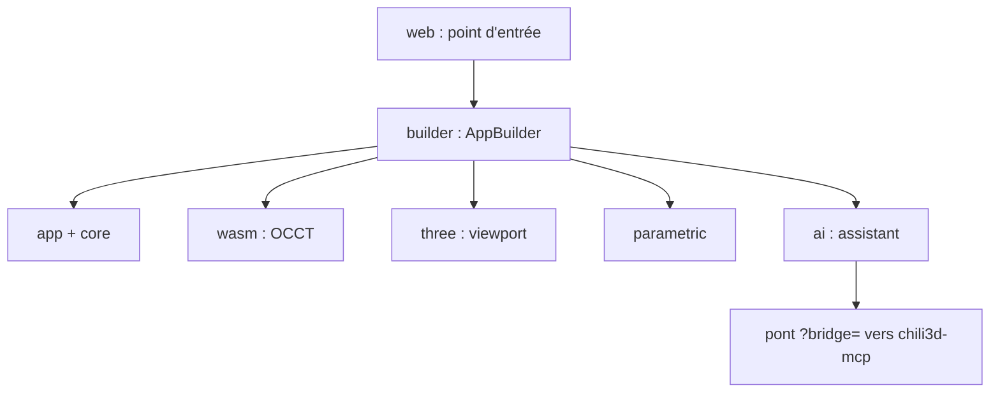

# xiangechen/chili3d

> 3D CAD in the browser (OpenCascade in WebAssembly), with an AI assistant that edits the same document.

## The problem
Parametric CAD is heavy to install, and an external AI assistant cannot modify the open model.

## What it actually does
TypeScript application: OpenCascade compiled to WebAssembly, Three.js rendering, parametric modeling (replayed function list), direct modeling and STEP, IGES, BREP, STL import or export. The assistant calls an LLM directly (Anthropic or OpenAI) with your key, reads and writes the same tree and the same undo stack, and a local WebSocket bridge (`?bridge=`) exposes the tools to an external agent.

## How it is wired


## Trying it
```bash
git clone https://github.com/xiangechen/chili3d.git
cd chili3d
npm install
npm run dev
docker compose up -d
```

## Cost and gotchas
Free (AGPL-3.0). The assistant asks for your API key, so billed calls; Node 24 recommended. The site uses Microsoft Clarity for statistics (to be removed from `public/index.html`). A commercial Pro edition exists.

## What it is not
Not a certified industrial CAD tool: the README disclaims all liability. The AI does not replace model verification.

## Alternatives
No alternative cited in the README.

## For you
Watch: interesting as an example of an AI agent plugged into tools, but CAD is outside your core field.
