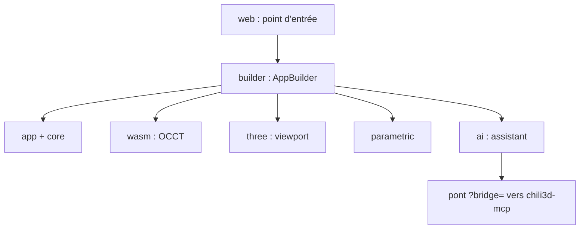

# xiangechen/chili3d

> CAO 3D dans le navigateur (OpenCascade en WebAssembly), avec un assistant IA qui modifie le même document.

## Le problème
La CAO paramétrique est lourde à installer, et un assistant IA externe ne peut pas modifier le modèle ouvert.

## Ce que ça fait vraiment
Application TypeScript : OpenCascade compilé en WebAssembly, rendu Three.js, modélisation paramétrique (liste de fonctions rejouée), modélisation directe et import ou export STEP, IGES, BREP, STL. L'assistant appelle directement un LLM (Anthropic ou OpenAI) avec ta clé, lit et écrit le même arbre et la même pile d'annulation, et un pont local WebSocket (`?bridge=`) expose les outils à un agent externe.

## Comment c'est branché


## Essayer
```bash
git clone https://github.com/xiangechen/chili3d.git
cd chili3d
npm install
npm run dev
docker compose up -d
```

## Coût et pièges
Gratuit (AGPL-3.0). L'assistant demande ta clé d'API, donc des appels facturés ; Node 24 recommandé. Le site utilise Microsoft Clarity pour des statistiques (à retirer de `public/index.html`). Une édition Pro commerciale existe.

## Ce que ce n'est pas
Pas un outil de CAO industriel certifié : le README décline toute responsabilité. L'IA ne remplace pas la vérification des modèles.

## Alternatives
Aucune alternative citée dans le README.

## Pour toi
À surveiller : intéressant comme exemple d'agent IA branché sur des outils, mais la CAO est hors de ton cœur de métier.

