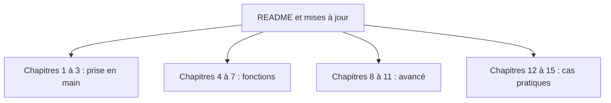

# xianyu110/awesome-openclaw-tutorial

> Tutorial book in Chinese for installing and using the OpenClaw AI assistant, from deployment to use cases.

## The problem
OpenClaw changes fast (breaking versions, migrations) and online guides quickly become outdated, especially for a Chinese-speaking audience.

## What it actually does
Fifteen chapters and fifteen appendices (about 408,000 characters) on installation, memory, automation, skills and integrations (Feishu, WeCom, DingTalk). Pinned to OpenClaw v2026.9.3; chapters 3, 4, 6 and 9 still contain old content. A print version exists.

## How it is wired
Simplified diagram based on the sheet, no diagram provided.



## Trying it
```bash
openclaw config set gateway.auth.mode token
openclaw config set gateway.auth.token "your-secret-token"
openclaw gateway restart
openclaw update --tag 2026.9.3 --yes
openclaw doctor --fix
```

## Cost and gotchas
Free to read; OpenClaw itself consumes model APIs (the text states 5 to 50 yuan per month) and some deployment services are paid. License not recognized by GitHub, although the text states GPL-3.0.

## What it is not
Not the official documentation: when in doubt, OpenClaw's docs take precedence. Not up to date everywhere: the historical sections should not be copied.

## Alternatives
The official OpenClaw documentation (docs.openclaw.ai) and the VoltAgent/awesome-openclaw-skills collection.

## For you
Ignore, unless you use OpenClaw and read Chinese: for a data / AI / MLOps profile, it is a mainstream tool guide with no technical value of its own.
