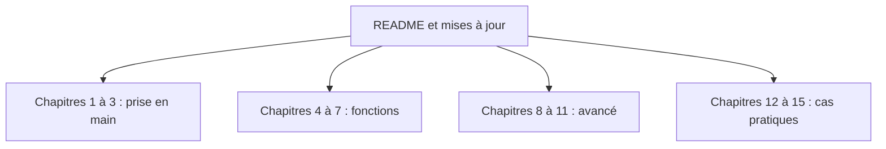

# xianyu110/awesome-openclaw-tutorial

> Livre-tutoriel en chinois pour installer et utiliser l'assistant IA OpenClaw, du déploiement aux cas d'usage.

## Le problème
OpenClaw change vite (ruptures de version, migrations) et les guides en ligne sont vite périmés, surtout pour un public chinophone.

## Ce que ça fait vraiment
Quinze chapitres et quinze annexes (environ 408 000 caractères) sur installation, mémoire, automatisation, skills et intégrations (Feishu, WeCom, DingTalk). Calé sur OpenClaw v2026.9.3 ; les chapitres 3, 4, 6 et 9 contiennent encore de l'ancien contenu. Une version papier existe.

## Comment c'est branché
Schéma simplifié d'après la fiche, sans diagramme fourni.



## Essayer
```bash
openclaw config set gateway.auth.mode token
openclaw config set gateway.auth.token "your-secret-token"
openclaw gateway restart
openclaw update --tag 2026.9.3 --yes
openclaw doctor --fix
```

## Coût et pièges
Lecture gratuite ; OpenClaw lui-même consomme des API de modèles (le texte annonce 5 à 50 yuans par mois) et certains services de déploiement sont payants. Licence non reconnue par GitHub, alors que le texte annonce GPL-3.0.

## Ce que ce n'est pas
Pas la documentation officielle : en cas de doute, la doc d'OpenClaw prime. Pas à jour partout : les sections historiques ne sont pas à recopier.

## Alternatives
La documentation officielle d'OpenClaw (docs.openclaw.ai) et la collection VoltAgent/awesome-openclaw-skills.

## Pour toi
À ignorer, sauf si tu utilises OpenClaw et lis le chinois : pour un profil data / IA / MLOps, c'est un guide d'outil grand public, sans valeur technique propre.

