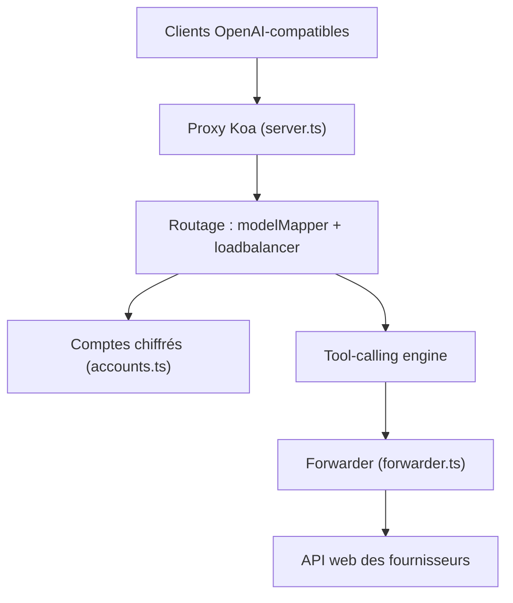

# xiaoY233/Chat2API

> Desktop application that exposes the web interfaces of DeepSeek, Kimi, Qwen and others as an OpenAI-compatible API.

## The problem
Models accessible for free through a provider's web interface cannot be used with clients that expect an OpenAI API.

## What it actually does
The Electron app stores the session tokens you retrieve from your browser, then launches a local Koa proxy (port 8080 by default) that accepts OpenAI requests (chat, completions, models) and translates them to each provider's web API. It handles load balancing across accounts, model name mapping, context management, tool calls via prompt injection, local API keys, logs and a dashboard.

## How it is wired


## Trying it
```bash
git clone https://github.com/xiaoY233/Chat2API.git
cd Chat2API
npm install
npx electron-vite dev 2>&1
```

## Cost and gotchas
"Zero cost" according to the README, but you need an account with each provider and must copy a session token from the browser developer tools. Credentials go into ~/.chat2api/accounts.json (encrypted). The providers' terms of use are not addressed.

## What it is not
Not an official API: these are hijacked web interfaces, which can change without notice. Tool calls go through prompt engineering, not native support. The license is present but unidentified.

## Alternatives
No alternative cited in the README.

## For you
Ignore: depending on website session tokens to feed your pipelines is fragile and has no guaranteed terms of use; prefer a real API key.
