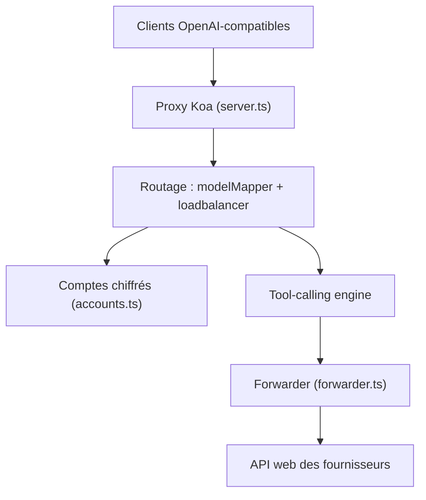

# xiaoY233/Chat2API

> Application de bureau qui expose les interfaces web de DeepSeek, Kimi, Qwen et autres comme une API compatible OpenAI.

## Le problème
Les modèles accessibles gratuitement par l'interface web d'un fournisseur ne s'utilisent pas avec les clients qui attendent une API OpenAI.

## Ce que ça fait vraiment
L'app Electron stocke les jetons de session que tu récupères dans le navigateur, puis lance un proxy Koa local (port 8080 par défaut) qui accepte des requêtes OpenAI (chat, completions, modèles) et les traduit vers l'API web de chaque fournisseur. Elle gère répartition de charge entre comptes, mappage de noms de modèles, gestion du contexte, appels d'outils par injection de prompt, clés d'API locales, journaux et tableau de bord.

## Comment c'est branché


## Essayer
```bash
git clone https://github.com/xiaoY233/Chat2API.git
cd Chat2API
npm install
npx electron-vite dev 2>&1
```

## Coût et pièges
« Zéro coût » selon le README, mais il faut un compte chez chaque fournisseur et copier un jeton de session depuis les outils développeur du navigateur. Les identifiants vont dans ~/.chat2api/accounts.json (chiffrés). Les conditions d'usage des fournisseurs ne sont pas abordées.

## Ce que ce n'est pas
Pas une API officielle : ce sont des interfaces web détournées, qui peuvent changer sans prévenir. Les appels d'outils passent par du prompt engineering, pas par un support natif. La licence est présente mais non identifiée.

## Alternatives
Aucune alternative citée dans le README.

## Pour toi
À ignorer : dépendre de jetons de session de sites web pour alimenter tes pipelines est fragile et sans garantie de conditions d'usage ; préfère une vraie clé d'API.

