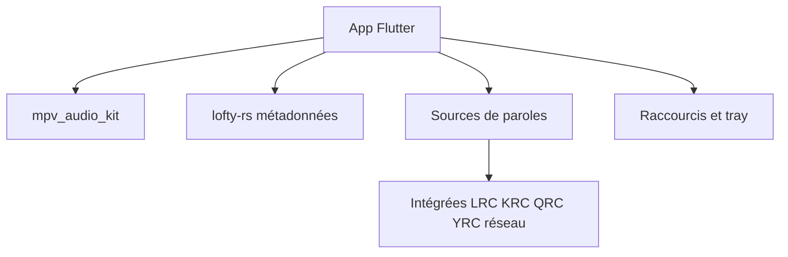

# xiaobaimc/myune_music

> Local music player in Flutter for Windows and Linux, with word-by-word lyrics and audio filters.

## The problem
Local players handle Asian lyrics formats (lrc, krc, qrc, yrc) and word-by-word synchronized lyrics poorly.

## What it actually does
Manages folder-based or manual playlists, sorts by artist and album, and plays embedded, local or network lyrics with adjustable priority. It offers an equalizer and filters, Windows exclusive mode, global shortcuts, ReplayGain and pinyin search. The audio engine relies on mpv, metadata on lofty-rs.

## How it is wired
Simplified diagram based on the sheet, no diagram supplied.



## Trying it
```bash
sudo apt install keybinder-3.0
flutter pub get
flutter run
flutter build windows --release
```

## Cost and gotchas
Free. Building requires Rust, Flutter ≥ 3.47.0 and Dart ≥ 3.10.0. No desktop lyrics (Flutter without multi-window). External lyrics must be in UTF-8.

## What it is not
It is not a streaming service: it plays local files. No macOS or mobile announced.

## Alternatives
For desktop lyrics, the README points to third-party tools: Lyricify Lite and BetterLyrics.

## For you
Ignore: a personal music player, unrelated to data/AI/MLOps work.
