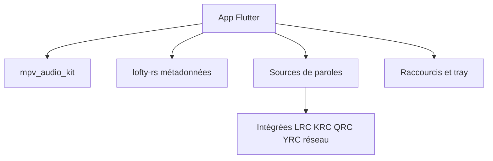

# xiaobaimc/myune_music

> Lecteur de musique local en Flutter pour Windows et Linux, avec paroles mot à mot et filtres audio.

## Le problème
Les lecteurs locaux gèrent mal les formats de paroles asiatiques (lrc, krc, qrc, yrc) et les paroles synchronisées mot à mot.

## Ce que ça fait vraiment
Gère des playlists de dossiers ou manuelles, classe par artiste et album, et lit les paroles intégrées, locales ou réseau avec priorité réglable. Il offre égaliseur et filtres, mode exclusif Windows, raccourcis globaux, ReplayGain et recherche par pinyin. Le moteur audio repose sur mpv, les métadonnées sur lofty-rs.

## Comment c'est branché
Schéma simplifié d'après la fiche, sans diagramme fourni.



## Essayer
```bash
sudo apt install keybinder-3.0
flutter pub get
flutter run
flutter build windows --release
```

## Coût et pièges
Gratuit. Compilation : Rust, Flutter ≥ 3.47.0 et Dart ≥ 3.10.0. Pas de paroles de bureau (Flutter sans multi-fenêtres). Les paroles externes doivent être en UTF-8.

## Ce que ce n'est pas
Ce n'est pas un service de streaming : il lit des fichiers locaux. Pas de macOS ni mobile annoncés.

## Alternatives
Pour les paroles de bureau, le README renvoie vers des outils tiers : Lyricify Lite et BetterLyrics.

## Pour toi
À ignorer : lecteur musical personnel, sans lien avec le travail data/IA/MLOps.

