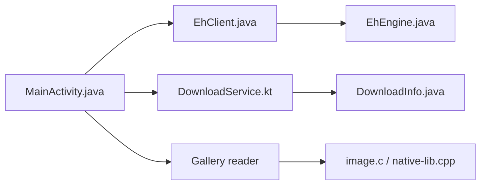

# xiaojieonly/Ehviewer_CN_SXJ

> Android browser for the E-Hentai gallery, with offline downloads, in Chinese.

## The problem
Browsing and reading E-Hentai galleries on mobile with downloads for offline reading.

## What it actually does
Android application: gallery browsing and search, detail view, image reader, download manager (dedicated service), archive and torrent downloads, import of local albums and Wi-Fi migration of downloads. Image and GIF decoding in native code. The README's version log is detailed. The target site's content is for adults.

## How it is wired


## Trying it
```bash
git clone https://github.com/xiaojieonly/Ehviewer_CN_SXJ.git
cd EhViewer
./gradlew app:assembleDebug
```

## Cost and gotchas
Free. APKs are offered via third-party storage drives (Baidu, Quark, Lanzou) and torrent. The code mentions Firebase Crashlytics and sending of analytics fields: probable telemetry. File management permissions are required.

## What it is not
Not an official client: the README warns that sites claiming to be "official" are fake. The diagram does not show all UI-service calls.

## Alternatives
No alternative named in the README (it thanks Hippo/seven332, founder of EhViewer).

## For you
Ignore: consumer application unrelated to your work, and its distribution model calls for caution.
